# Product Implementation, Validation & Deployment
<a id="product-implementation-validation-deployment"></a>

## 5.1. Software Configuration Management
<a id="5-1-software-configuration-management"></a>

En esta sección el equipo establece las decisiones y convenciones que permiten mantener la consistencia durante el ciclo de vida de los productos digitales de EcoRoad: Landing Page, Frontend Web Application y Web Services.

### 5.1.1. Software Development Environment Configuration
<a id="5-1-1-software-development-environment-configuration"></a>

#### Project Management
Para la coordinación del proyecto y el seguimiento del trabajo colaborativo se utilizaron plataformas de comunicación, almacenamiento y gestión ágil. El código fuente del informe, la Landing Page y la Web Application se centralizó en una organización pública de GitHub. Las reuniones virtuales del equipo y las coordinaciones diarias se realizaron mediante Discord y WhatsApp, mientras que la planificación y asignación de tareas de cada Sprint se gestionó en Trello.

* **Coordinación de código y repositorios:** GitHub — https://github.com/
* **Reuniones virtuales y syncs:** Discord — https://discord.com/
* **Comunicación diaria:** WhatsApp — https://www.whatsapp.com/
* **Organización y seguimiento de tareas (Sprint Board):** Trello — https://trello.com/

#### Requirements Management
Durante el análisis y la especificación de requisitos se empleó UXPressia para diseñar los User Personas, Empathy Maps, Journey Maps e Impact Maps. Se utilizó Miro para la construcción de los tableros de EventStorming.

* **User Personas, Empathy Maps, Journey Maps e Impact Map:** UXPressia — https://uxpressia.com/
* **EventStorming:** Miro — https://miro.com/
* **Gestión de User Stories y Sprint Backlog:** Trello — https://trello.com/

#### Product UX/UI Design
Para la concepción visual de la Landing Page y de la Web Application, el equipo empleó Figma. Se elaboraron wireframes, mock-ups y prototipos para validar la estructura visual, la paleta de colores y la disposición de las secciones antes de su implementación.

* **Wireframes, Mock-ups y Prototypes:** Figma — https://www.figma.com/

#### Software Development
La Landing Page se implementó con HTML5, CSS3 y JavaScript. La Frontend Web Application se implementó con Vue 3, Vue Router y PrimeVue; Vite se utiliza para construirla y Node.js para las tareas de desarrollo. Durante el Sprint 2 se utilizó una Fake API en Node.js. En el Sprint 3 se integró la aplicación con Web Services reales implementados en C# con ASP.NET Core, Entity Framework Core y MySQL.

* **IDEs y editores:** Visual Studio Code — https://code.visualstudio.com/ ; WebStorm — https://www.jetbrains.com/webstorm/ ; JetBrains Rider (para C#) — https://www.jetbrains.com/rider/
* **Gestor de IDEs:** JetBrains Toolbox — https://www.jetbrains.com/toolbox-app/
* **Entorno de ejecución:** Node.js LTS — https://nodejs.org/
* **Framework y bibliotecas frontend:** Vue 3 — https://vuejs.org/ ; PrimeVue — https://primevue.org/ ; Vite — https://vite.dev/
* **Framework backend:** ASP.NET Core / .NET SDK — https://dotnet.microsoft.com/download
* **Control de versiones:** Git — https://git-scm.com/downloads

#### Software Documentation
El informe del proyecto se redacta en archivos Markdown (.md) dentro del repositorio del informe en GitHub. En el Sprint 3 los Web Services publicaron un documento OpenAPI y una referencia interactiva con Scalar.

* **Informe:** Markdown en GitHub — https://github.com/Aplicaciones-Web-1ASI0730-2620-8130/Grupo1---Report
* **Documentación de Web Services:** OpenAPI y Scalar — https://ecoroad-back-end-production.up.railway.app/scalar

#### Software Deployment
La Landing Page se publica en GitHub Pages. La primera versión de la Web Application se publicó en Vercel durante el Sprint 2; la versión integrada del Sprint 3 se publica en Railway junto con el backend ASP.NET Core y MySQL.

* **Landing Page:** GitHub Pages — https://pages.github.com/
* **Primera versión del frontend (Sprint 2):** Vercel — https://vercel.com/
* **Versión integrada (Sprint 3):** Railway — https://railway.com/

### 5.1.2. Source Code Management
<a id="5-1-2-source-code-management"></a>

El equipo gestiona el código fuente mediante **GitHub** como plataforma de control de versiones, organizado bajo una organización pública que agrupa los repositorios de cada producto digital del proyecto.

| Producto | Repositorio | Despliegue |
| :--- | :--- | :--- |
| Project Report | https://github.com/Aplicaciones-Web-1ASI0730-2620-8130/Grupo1---Report | — |
| Landing Page | https://github.com/Aplicaciones-Web-1ASI0730-2620-8130/EcoRoad-LandingPage | https://aplicaciones-web-1asi0730-2620-8130.github.io/EcoRoad-LandingPage/ |
| Frontend Web Application | https://github.com/Aplicaciones-Web-1ASI0730-2620-8130/EcoRoad-FrontEnd | https://ecoroad-frontend-production.up.railway.app/ |
| Web Services | https://github.com/Aplicaciones-Web-1ASI0730-2620-8130/EcoRoad-Back-End | https://ecoroad-back-end-production.up.railway.app/scalar |

#### GitFlow Workflow

El equipo documentó **GitFlow** como modelo de ramificación para el trabajo inicial. El historial de los repositorios también registra commits directos y Pull Requests de integración en etapas posteriores; por ello, la siguiente lista describe el flujo previsto y no una regla cumplida por todos los cambios:

- **`main`**: rama principal que contiene la versión estable publicada. Solo recibe merges desde `release` o `hotfix`.
- **`develop`**: rama de integración donde se consolidan los features completados antes de pasar a producción.
- **Feature branches**: se crean desde `develop` y se integran de vuelta a `develop` mediante Pull Request. Convenciones:
  - Project Report: `featureNN/Chapter-<número>-<nombre-del-capítulo>`, por ejemplo `feature50/Chapter-V-product-implementation-validation-and-deployment`.
  - Landing Page: `feature/<nombre-sección>`, por ejemplo `feature/hero-section`.
  - Frontend Web Application: `ft-<Bounded-Context>`, una rama por bounded context, por ejemplo `ft-Project-and-Road-Site-Management` o `ft-Incident-and-Remediation-Management`.
- **`release/<versión>`**: rama de preparación de una nueva versión. Se crea desde `develop` al cierre del Sprint. Ejemplo: `release/1.0.0`.
- **`hotfix/<descripción>`**: rama para correcciones críticas en producción. Se crea desde `main`. Ejemplo: `hotfix/fix-cta-redirect`.

#### Semantic Versioning

Para el nombramiento de versiones se aplica **Semantic Versioning 2.0.0** con el formato `MAJOR.MINOR.PATCH`:
- `MAJOR`: cambios incompatibles con versiones anteriores.
- `MINOR`: nuevas funcionalidades compatibles con versiones anteriores.
- `PATCH`: correcciones de errores compatibles con versiones anteriores.

Las versiones `v1.0.0` y `v1.1.0` mencionadas en la planificación describen hitos previstos. Antes de declararlas versiones publicadas en este informe se deben comprobar las etiquetas correspondientes en Git. El despliegue del Sprint 3 se identifica aquí por sus commits y direcciones, sin asignarle un número de versión no verificado.

#### Conventional Commits

Para los mensajes de commit, el equipo aplica la especificación **Conventional Commits**, usando el formato:

```
<type>(<scope>): <description>
```

Los tipos permitidos son:
- `feat`: nueva funcionalidad.
- `fix`: corrección de error.
- `docs`: cambios en documentación.
- `style`: cambios de formato que no afectan la lógica.
- `refactor`: reestructuración de código sin cambio funcional.
- `chore`: tareas de mantenimiento (dependencias, configuración).
- `test`: adición o modificación de pruebas.

Ejemplos aplicados al proyecto:
```
docs(chapter5): add sprint 2 development evidence
feat(projects): manage road sections and work fronts
feat(incidents): add incident lifecycle and remediation board
fix(deploy): serve demo API and authentication on Vercel
feat(landing): link sign-in to deployed frontend
```

### 5.1.3. Source Code Style Guide & Conventions
<a id="5-1-3-source-code-style-guide-conventions"></a>

El equipo adopta las siguientes guías de estilo y convenciones de codificación para garantizar uniformidad y legibilidad en todos los productos. Toda nomenclatura en el código se redacta en **inglés**.

#### HTML5 & CSS3 (Landing Page y templates de la Web Application)
- Se aplica la guía **W3Schools HTML Style Guide and Coding Conventions**: estructura semántica, indentación con 2 espacios, elementos y atributos en minúsculas y uso de comillas dobles.
- Se aplica la guía **Google HTML/CSS Style Guide**: nombres de clases en `kebab-case`, se evita el uso de selectores de ID en CSS y se priorizan las propiedades abreviadas.
- El lenguaje de diseño se basa en **Material Design**.

#### JavaScript & Vue (Frontend Web Application)
- Se aplica la **Vue Style Guide** oficial: componentes con nombres multi-palabra, archivos de componentes en `kebab-case` (por ejemplo `project-list.vue`, `incident-board.vue`) y props declaradas de forma detallada.
- Se aplican **Google JavaScript Style Guide**, **MDN JavaScript guidelines** y **W3C JavaScript Style Guide**: `camelCase` para variables y funciones, `PascalCase` para clases, `const`/`let` en lugar de `var` y módulos ES.
- El código se organiza por bounded context y por capas: `domain`, `application`, `infrastructure` y `presentation` (por ejemplo `src/projects/presentation/views/project-list.vue`).
- Los componentes de interfaz se construyen con **PrimeVue**.

#### C# & ASP.NET Core (Web Services)
- Se aplican las **C# Coding Conventions** de Microsoft: `PascalCase` para clases, métodos y propiedades públicas; `camelCase` para parámetros y variables locales; prefijo `I` para interfaces.
- Se emplean controladores con sufijo `Controller`, rutas bajo `/api/` (por ejemplo `/api/projects`) e inyección de dependencias. Los contratos reales se consultan en la documentación OpenAPI publicada.

#### Gherkin (Acceptance Criteria)
- Se aplican las **Gherkin Conventions for Readable Specifications**: un solo nivel de indentación para `Given/When/Then`, escenarios redactados en tercera persona y en tiempo presente, sin referencias a detalles de interfaz.

### 5.1.4. Software Deployment Configuration
<a id="5-1-4-software-deployment-configuration"></a>

En esta sección se describe la configuración de despliegue de los productos digitales hasta el Sprint 3. Se conserva el despliegue de Vercel como antecedente histórico del Sprint 2.

#### Landing Page — GitHub Pages

El Landing Page de EcoRoad se despliega como sitio web estático mediante **GitHub Pages**, directamente desde su repositorio.

1. Asegurarse de que la rama `main` contiene `index.html` y la carpeta `assets/` del Landing Page.
2. Ingresar al repositorio en GitHub y navegar a **Settings > Pages**.
3. En la sección **Source**, seleccionar la rama `main` y la carpeta `/ (root)`.
4. Hacer clic en **Save**. GitHub Pages genera automáticamente la URL de despliegue.
5. Verificar el sitio desplegado en https://aplicaciones-web-1asi0730-2620-8130.github.io/EcoRoad-LandingPage/

Cualquier push a la rama `main` actualiza automáticamente el sitio desplegado.

#### Frontend Web Application — Vercel

La primera versión de la Web Application de EcoRoad (Vue 3 + Vite) se desplegó en **Vercel**, conectado al repositorio `EcoRoad-FrontEnd`. Esta configuración corresponde al Sprint 2 y no a la versión integrada actual.

1. Ingresar a https://vercel.com/ con la cuenta de GitHub del equipo y seleccionar **Add New > Project**.
2. Importar el repositorio `Aplicaciones-Web-1ASI0730-2620-8130/EcoRoad-FrontEnd`.
3. Configurar el proyecto: **Root Directory** `./`, **Build Command** `npm run build` y **Output Directory** `dist`.
4. El archivo `vercel.json` del repositorio define las reglas de *rewrite*: las rutas `/api/*` se dirigen a la función serverless `api/index.js`, que expone la Fake API, y el resto de rutas se dirige a `index.html` para que Vue Router resuelva la navegación de la SPA.
5. Hacer clic en **Deploy**. Vercel construye la aplicación y publica la URL https://ecoroad-frontend-ddli-peach.vercel.app/
6. Cada push a la rama configurada genera un nuevo despliegue de forma automática.

#### Versión integrada — Railway

En el Sprint 3 se publicaron servicios separados para el frontend Vue, el backend ASP.NET Core y MySQL en el entorno `production` de Railway. El backend se construye con el `Dockerfile` del repositorio y recibe la conexión a la base de datos mediante `ConnectionStrings__DefaultConnection`, cuyo valor no se incluye en el informe. El frontend público utiliza el backend real. La Landing Page en GitHub Pages apunta a `https://ecoroad-frontend-production.up.railway.app` mediante `assets/app-config.js`. La evidencia visual y las direcciones de los servicios se presentan en 5.2.3.7.

## 5.2. Landing Page, Services & Applications Implementation
<a id="5-2-landing-page-services-applications-implementation"></a>

### 5.2.1. Sprint 1
<a id="5-2-1-sprint-1"></a>

#### 5.2.1.1. Sprint Planning 1
<a id="5-2-1-1-sprint-planning-1"></a>

El Sprint 1 se planificó con el propósito de implementar y desplegar la primera versión del Landing Page de EcoRoad. A continuación se resume la reunión de Sprint Planning.

| Sprint # | Sprint 1 |
| :--- | :--- |
| **Sprint Planning Background** | |
| Date | 2026-09-16 |
| Time | 07:00 PM |
| Location | Reunión virtual vía Discord |
| Prepared By | Pancorbo Amorós, Italo Raul |
| Attendees | Taza Curay, Eduardo Miguel / Roman Lopez, Miguel Angel Junior / Guillen Chavez, Eduardo Martín / Salcedo Muñoz, Andy Alfredo Hipolito / Pancorbo Amorós, Italo Raul |
| Sprint 0 Review Summary | Al ser el primer Sprint del proyecto, no existe un Sprint anterior. Se parte del Product Backlog inicial y de los artefactos de diseño elaborados en los capítulos previos. |
| Sprint 0 Retrospective Summary | El equipo acordó establecer estándares de trabajo desde el inicio: aplicar GitFlow, Conventional Commits y dividir las responsabilidades de implementación del Landing Page por secciones entre los miembros. |
| **Sprint Goal & User Stories** | |
| Sprint 1 Goal | Our focus is on delivering a fully deployed and navigable Landing Page for EcoRoad. We believe it delivers a clear understanding of the value proposition to potential clients from both target segments (road construction companies and road maintenance and rehabilitation companies). This will be confirmed when visitors can navigate all sections of the Landing Page, identify the environmental monitoring features, compare subscription plans, and access the call-to-action buttons for each segment. |
| Sprint 1 Velocity | 20 Story Points |
| Sum of Story Points | 19 Story Points |

#### 5.2.1.2. Aspect Leaders and Collaborators
<a id="5-2-1-2-aspect-leaders-and-collaborators"></a>

Para el Sprint 1, los aspectos de trabajo se organizan en torno a las secciones del Landing Page y la configuración del entorno de desarrollo y despliegue. Cada aspecto cuenta con un líder responsable de su implementación y uno o más colaboradores de apoyo.

| Team Member | GitHub Username | Hero & Navbar | Plans Section | Features Section | Contact Form | Deployment & Config |
|:---|:---|:---:|:---:|:---:|:---:|:---:|
| Taza Curay, Eduardo Miguel | Edutaza10 | L | C | | | C |
| Roman Lopez, Miguel Angel Junior | MiguelRomn | C | | L | C | C |
| Guillen Chavez, Eduardo Martín | Eduardox30-wq | C | | C | L | |
| Salcedo Muñoz, Andy Alfredo Hipolito | Andy777sdw | | L | C | | C |
| Pancorbo Amorós, Italo Raul | pancorboitalo-design | | C | C | | L |

*L = Leader | C = Collaborator*

#### 5.2.1.3. Sprint Backlog 1
<a id="5-2-1-3-sprint-backlog-1"></a>

El objetivo principal de este Sprint es implementar y desplegar la primera versión del Landing Page de EcoRoad, cubriendo las secciones de presentación de valor, funcionalidades, planes de suscripción, testimonios y formulario de contacto, con call-to-action diferenciados para cada segmento objetivo.

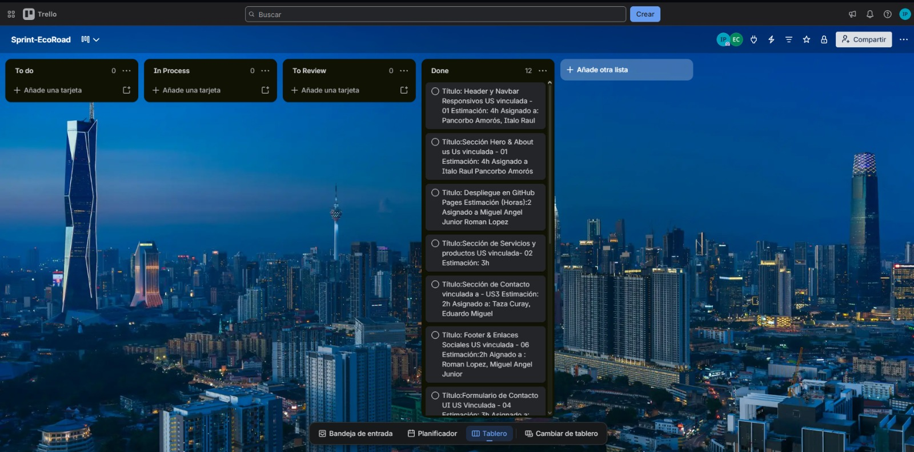

[Tablero de Trello: Organización del Sprint - EcoRoad](https://trello.com/invite/b/6ab0928cab1e6c824069d8ae/ATTI8217aefaf5493c7dc99f935bc7566209F12E82AE/sprint-ecoroad)

| US / TS / Task ID | Título | Descripción de Tarea | Estimación (Horas) | Integrante Asignado | Estado |
| :--- | :--- | :--- | :---: | :--- | :---: |
| **US001 / CC01** | Header y Navbar Responsivos | Maquetación y estilos responsive del encabezado y menú de navegación. | 4 | Pancorbo Amorós, Italo Raul | Done |
| **US001 / CC02** | Sección Hero & About Us | Maquetación visual de la sección principal y presentación de la empresa. | 4 | Pancorbo Amorós, Italo Raul | Done |
| **US002 / CC03** | Sección de Servicios y Producto | Maquetación de tarjetas informativas con las funcionalidades del SaaS. | 3 | Salcedo Muñoz, Andy Alfredo Hipolito | Done |
| **US003 / CC04** | Sección de Contacto | Maquetación de la sección informativa de canales de comunicación. | 2 | Taza Curay, Eduardo Miguel | Done |
| **US004 / CC05** | Formulario de Contacto UI | Desarrollo de la interfaz del formulario y validaciones en tiempo real. | 3 | Taza Curay, Eduardo Miguel | Done |
| **TS001 / CC06** | Footer & Enlaces Sociales | Maquetación del pie de página y enlaces a redes de la plataforma. | 2 | Roman Lopez, Miguel Angel Junior | Done |
| **TS001 / CC07** | Despliegue en GitHub Pages | Configuración del despliegue continuo desde la rama `main`. | 2 | Roman Lopez, Miguel Angel Junior | Done |
| **DOC01** | Informe Capítulo I | Introducción, problema, objetivos, justificación y restricciones. | 5 | Pancorbo Amorós, Italo Raul | Done |
| **DOC02** | Informe Capítulo II | Análisis del dominio, entrevistas, User Personas, Empathy Maps. | 6 | Salcedo Muñoz, Andy Alfredo Hipolito | Done |
| **DOC03** | Informe Capítulo III | Impact Mapping, User Stories y Product Backlog. | 8 | Guillen Chavez, Eduardo Martín / Taza Curay, Eduardo Miguel | Done |
| **DOC04** | Informe Capítulo IV | Arquitectura de Software, Domain-Driven Design y diagramas C4. | 6 | Roman Lopez, Miguel Angel Junior | Done |
| **DOC05** | Informe Capítulo V | Configuration Management, Sprint Planning 1 y evidencias de Sprint. | 5 | Guillen Chavez, Eduardo Martín | Done |

#### 5.2.1.4. Development Evidence for Sprint Review
<a id="5-2-1-4-development-evidence-for-sprint-review"></a>

En esta sección se presentan las evidencias correspondientes al desarrollo realizado durante el Sprint 1 del proyecto EcoRoad. Durante este Sprint, el equipo se enfocó en la implementación de la Landing Page, considerando la estructura visual, la navegación, la presentación de la propuesta de valor, los beneficios, las funcionalidades, los planes de suscripción, el equipo de trabajo y los elementos de contacto. Asimismo, se adaptó la interfaz a diferentes dispositivos, se incorporó un selector de idioma inglés/español y se publicó la Landing Page mediante GitHub Pages.

**Repository:** https://github.com/Aplicaciones-Web-1ASI0730-2620-8130/EcoRoad-LandingPage

**Deployed Landing Page:** https://aplicaciones-web-1asi0730-2620-8130.github.io/EcoRoad-LandingPage/

| Repository | Branch | Commit Id | Commit Message | Commit Message Body | Committed on (Date) |
| --- | --- | --- | --- | --- | --- |
| Aplicaciones-Web-1ASI0730-2620-8130/EcoRoad-LandingPage | main | d4db12f | feat: implement EcoRoad landing page | Implementación inicial de la Landing Page de EcoRoad, incluyendo su estructura principal, navegación y secciones informativas. | 19/09/2026 |
| Aplicaciones-Web-1ASI0730-2620-8130/EcoRoad-LandingPage | main | ea5e78f | fix: rename index file for GitHub Pages | Renombrado del archivo principal a `index.html` para su publicación en GitHub Pages. | 19/09/2026 |
| Aplicaciones-Web-1ASI0730-2620-8130/EcoRoad-LandingPage | main | 910f5d4 | fix: improve EcoRoad footer layout | Mejora de la estructura del footer: módulos, marco regulatorio, información de contacto y enlaces adicionales. | 19/09/2026 |
| Aplicaciones-Web-1ASI0730-2620-8130/EcoRoad-LandingPage | main | 51b5e02 | feat: add EcoRoad call to action section | Incorporación del call-to-action para solicitar demostraciones o contactar con especialistas. | 19/09/2026 |
| Aplicaciones-Web-1ASI0730-2620-8130/EcoRoad-LandingPage | main | 2525e7f | feat: improve responsive design for mobile devices | Adaptación de la Landing Page para su correcta visualización en computadoras, tablets y dispositivos móviles. | 19/09/2026 |
| Aplicaciones-Web-1ASI0730-2620-8130/EcoRoad-LandingPage | main | f37feac | feat: add English and Spanish language switcher | Incorporación del selector de idioma inglés/español (i18n). | 19/09/2026 |
| Aplicaciones-Web-1ASI0730-2620-8130/EcoRoad-LandingPage | main | 0fb8717 | Add team member profiles | Incorporación de los perfiles de los integrantes del equipo. | 20/09/2026 |

#### 5.2.1.5. Execution Evidence for Sprint Review
<a id="5-2-1-5-execution-evidence-for-sprint-review"></a>

Durante el presente Sprint se logró implementar y desplegar una primera versión funcional de la Landing Page de EcoRoad, orientada a presentar la propuesta de valor de la solución, sus principales funcionalidades, beneficios y planes de suscripción.

La Landing Page fue desarrollada utilizando HTML, CSS y JavaScript, incorporando una estructura responsive que permite su correcta visualización tanto en computadoras como en dispositivos móviles. Asimismo, se implementaron diferentes componentes interactivos que mejoran la experiencia de navegación del usuario.

**Resumen de logros**

- **Implementación de la Landing Page:** se desarrolló una primera versión funcional de EcoRoad, presentando de manera clara su propuesta de valor orientada al monitoreo y la gestión ambiental en proyectos de infraestructura vial.
- **Presentación de soluciones y beneficios:** se incorporaron secciones que muestran las principales soluciones de monitoreo ambiental, así como beneficios relacionados con reducción de riesgos, automatización de auditorías y trazabilidad georreferenciada.
- **Presentación de funcionalidades y modelo SaaS:** se implementaron secciones para mostrar funcionalidades como dashboards georreferenciados, alertas ambientales, trazabilidad de evidencias y generación de reportes, además de los planes de suscripción de la plataforma.
- **Secciones de equipo y contacto:** se añadieron las secciones de presentación del equipo y call-to-action, permitiendo al usuario conocer a los integrantes del proyecto y acceder a opciones de contacto o solicitud de demostración.
- **Diseño responsive e internacionalización:** la Landing Page fue adaptada para computadoras, tablets y smartphones, e incorpora un selector de idioma que permite alternar el contenido principal entre inglés y español.
- **Despliegue mediante GitHub Pages:** la solución fue publicada en un entorno web público, permitiendo validar su funcionamiento desde distintos dispositivos.

Video de demostración y navegación: [Link](https://upcedupe-my.sharepoint.com/:v:/g/personal/u20241d483_upc_edu_pe/IQAkn3u2kvFiTqMHYbNb0IjtAX7jKxhOE-uMBPIxo2_Q5Ys?nav=eyJyZWZlcnJhbEluZm8iOnsicmVmZXJyYWxBcHAiOiJPbmVEcml2ZUZvckJ1c2luZXNzIiwicmVmZXJyYWxBcHBQbGF0Zm9ybSI6IldlYiIsInJlZmVycmFsTW9kZSI6InZpZXciLCJyZWZlcnJhbFZpZXciOiJNeUZpbGVzTGlua0NvcHkifX0&e=Aga9p0)

Screenshot de la implementación:


#### 5.2.1.6. Services Documentation Evidence for Sprint Review
<a id="5-2-1-6-services-documentation-evidence-for-sprint-review"></a>

En este Sprint no se desarrollaron endpoints REST ni Web Services propios, debido a que el alcance estuvo enfocado en la implementación del Landing Page con HTML, CSS y JavaScript. Por ello, no existe documentación OpenAPI asociada a este Sprint. Se registra a continuación el recurso publicado y el repositorio que contiene su código fuente.

| Recurso | Acción implementada | HTTP | URL | Repositorio |
| :--- | :--- | :---: | :--- | :--- |
| Landing Page | Vista inicial y navegación de EcoRoad | GET | https://aplicaciones-web-1asi0730-2620-8130.github.io/EcoRoad-LandingPage/ | https://github.com/Aplicaciones-Web-1ASI0730-2620-8130/EcoRoad-LandingPage |

#### 5.2.1.7. Software Deployment Evidence for Sprint Review
<a id="5-2-1-7-software-deployment-evidence-for-sprint-review"></a>

Durante el Sprint 1 el despliegue se centró en la publicación del Landing Page como sitio web estático en GitHub Pages. Las actividades realizadas fueron:

1. **Creación del repositorio** `EcoRoad-LandingPage` dentro de la organización pública `Aplicaciones-Web-1ASI0730-2620-8130`.
2. **Preparación de la estructura del proyecto:** el archivo principal se renombró a `index.html` (commit `ea5e78f`) para que GitHub Pages lo reconozca como página de inicio.
3. **Configuración de GitHub Pages:** en **Settings > Pages** se seleccionó como origen la rama `main` y la carpeta `/ (root)`.
4. **Verificación del despliegue:** se comprobó el acceso al sitio publicado en https://aplicaciones-web-1asi0730-2620-8130.github.io/EcoRoad-LandingPage/ desde navegadores de escritorio y móviles.


#### 5.2.1.8. Team Collaboration Insights during Sprint
<a id="5-2-1-8-team-collaboration-insights-during-sprint"></a>

Durante el Sprint 1 el trabajo de implementación del Landing Page y de elaboración del informe se distribuyó entre los integrantes según la matriz de Aspect Leaders and Collaborators. La integración de los aportes al informe se realizó mediante Pull Requests desde las ramas de cada capítulo hacia la rama `develop`, siguiendo GitFlow, y la coordinación técnica se mantuvo a través de Discord y WhatsApp. A continuación se presentan los analíticos de colaboración de GitHub.

**Analíticos de GitHub — Report**

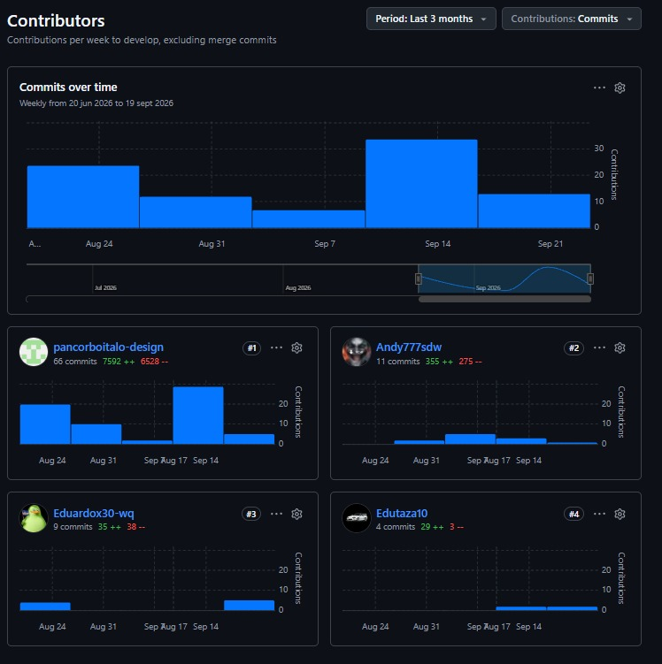

**Analíticos de GitHub — Landing Page**

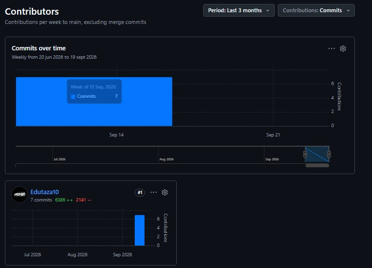

| Integrante | Usuario GitHub | Commits (Report) |
|---|---|---|
| Guillen Chavez, Eduardo Martín | Eduardox30-wq | 9 |
| Pancorbo Amorós, Italo Raul | pancorboitalo-design | 66 |
| Roman Lopez, Miguel Angel Junior | MiguelRomn | 0 |
| Taza Curay, Eduardo Miguel | Edutaza10 | 11 |
| Salcedo Muñoz, Andy Alfredo Hipolito | Andy777sdw | 11 |

### 5.2.2. Sprint 2
<a id="5-2-2-sprint-2"></a>

#### 5.2.2.1. Sprint Planning 2
<a id="5-2-2-1-sprint-planning-2"></a>

El Sprint 2 se planificó con el propósito de implementar y desplegar la primera versión de la Frontend Web Application de EcoRoad, cubriendo los ocho bounded contexts del dominio, y de actualizar el Landing Page para que su call-to-action dirija a la Web Application desplegada. A continuación se resume la reunión de Sprint Planning.

| Sprint # | Sprint 2 |
| :--- | :--- |
| **Sprint Planning Background** | |
| Date | 2026-10-08 |
| Time | 08:00 PM |
| Location | Reunión virtual vía Discord |
| Prepared By | Pancorbo Amorós, Italo Raul |
| Attendees | Taza Curay, Eduardo Miguel / Roman Lopez, Miguel Angel Junior / Guillen Chavez, Eduardo Martín / Salcedo Muñoz, Andy Alfredo Hipolito / Pancorbo Amorós, Italo Raul |
| Sprint 1 Review Summary | Durante el Sprint 1 se entregó la Landing Page completa y responsive de EcoRoad desplegada en GitHub Pages, con selector de idioma inglés/español, junto con la documentación técnica de los Capítulos I al V del informe. |
| Sprint 1 Retrospective Summary | El equipo mantuvo una sólida coordinación. Se identificó la necesidad de estandarizar las convenciones de arquitectura en Vue, definir una estructura uniforme por bounded context (domain, application, infrastructure, presentation), organizar la API simulada y sus relaciones de datos, y unificar el flujo GitFlow mediante nombres de ramas estandarizados por bounded context. |
| **Sprint Goal & User Stories** | |
| Sprint 2 Goal | Our focus is on delivering the first version of the EcoRoad Web Application, so that road construction and road maintenance companies can register their road projects, deploy monitoring points and IoT sensors, follow environmental indicators and alerts, manage incidents until their closure and generate compliance reports. We believe it delivers centralized and traceable visibility of environmental compliance to environmental engineers, site directors and project managers of both target segments. This will be confirmed when a user, coming from the Landing Page call-to-action, signs in to the deployed Web Application, registers a road project with its sections, reviews the environmental dashboard and the generated alerts, takes an incident from "Pendiente" to "Cerrada" with registered evidence, and generates a compliance report for a selected period. |
| Sprint 2 Velocity | 75 Story Points |
| Sum of Story Points | 72 Story Points |

#### 5.2.2.2. Aspect Leaders and Collaborators
<a id="5-2-2-2-aspect-leaders-and-collaborators"></a>

Para el Sprint 2, los aspectos de trabajo corresponden a los ocho bounded contexts implementados en la Frontend Web Application, más la actualización y el despliegue del Landing Page y de la Web Application. Cada aspecto cuenta con un líder responsable y colaboradores de apoyo.

| Team Member | GitHub Username | Commercial & Subscription | IAM | Project & Road Site | Monitoring Asset & Deployment | Environmental Monitoring | Alerting & Risk Evaluation | Incident & Remediation | Compliance & Reporting | Landing Page & Deployment |
|:---|:---|:---:|:---:|:---:|:---:|:---:|:---:|:---:|:---:|:---:|
| Taza Curay, Eduardo Miguel | Edutaza10 | | | L | L | | | | C | |
| Roman Lopez, Miguel Angel Junior | MiguelRomn | L | L | | | | | C | | C |
| Guillen Chavez, Eduardo Martín | Eduardox30-wq | | | | C | L | L | | | |
| Salcedo Muñoz, Andy Alfredo Hipolito | Andy777sdw | | C | | L | | | L | | |
| Pancorbo Amorós, Italo Raul | pancorboitalo-design | C | | L | | C | | | L | L |

*L = Leader | C = Collaborator*

#### 5.2.2.3. Sprint Backlog 2
<a id="5-2-2-3-sprint-backlog-2"></a>

El objetivo principal de este Sprint es implementar y desplegar la primera versión de la Frontend Web Application de EcoRoad con Vue 3 y PrimeVue, consumiendo una Fake API que simula los futuros Web Services, y actualizar el Landing Page para redirigir a la aplicación desplegada.


| Sprint # | Sprint 2 | | | | | | |
| :--- | :--- | :--- | :--- | :--- | :---: | :--- | :---: |
| **Story Id** | **Story Title** | **Task Id** | **Task Title** | **Task Description** | **Estimation (Hours)** | **Assigned To** | **Status** |
| US27 | CTA Segmento Constructoras Viales | T2-01 | Enlace de CTA hacia la Web Application | Actualizar los call-to-action del Landing Page para redirigir al inicio de sesión de la Web Application desplegada. | 1 | Pancorbo Amorós, Italo Raul | Done |
| US28 | CTA Segmento Mantenimiento Vial | T2-02 | Redirección al portafolio tras autenticación | Configurar la redirección del visitante hacia la vista de proyectos después de iniciar sesión. | 1 | Pancorbo Amorós, Italo Raul | Done |
| US01 | Autenticación de Usuarios | T2-03 | Vista de inicio de sesión | Implementar la vista de inicio de sesión, la sesión de usuario y la protección de rutas. | 4 | Salcedo Muñoz, Andy Alfredo Hipolito | Done |
| US25 | Registro de Colaboradores y Asignación de Permisos | T2-04 | Gestión de colaboradores | Implementar la vista de colaboradores con invitación, asignación de rol y permisos. | 4 | Salcedo Muñoz, Andy Alfredo Hipolito | Done |
| US26 | Restricción de Acceso según Permisos Asignados | T2-05 | Vista de acceso denegado y guardas de ruta | Restringir el acceso a vistas según los permisos del colaborador e implementar la vista de acceso denegado. | 3 | Salcedo Muñoz, Andy Alfredo Hipolito | Done |
| US30 | Creación de Proyecto Vial | T2-06 | Registro de proyectos viales | Implementar el formulario de registro de proyecto vial con validación de campos obligatorios. | 4 | Pancorbo Amorós, Italo Raul | Done |
| US30 | Creación de Proyecto Vial | T2-07 | Gestión de tramos y frentes de trabajo | Implementar el alta, edición y eliminación de tramos y frentes de trabajo de un proyecto. | 4 | Pancorbo Amorós, Italo Raul | Done |
| US11 | Visualización General de Proyectos | T2-08 | Listado de proyectos | Implementar la vista de listado de proyectos con estado ambiental, sensores, alertas e incidencias. | 3 | Pancorbo Amorós, Italo Raul | Done |
| US12 | Consulta de Resumen de un Proyecto | T2-09 | Detalle de proyecto | Implementar la vista de detalle de un proyecto con sus tramos. | 2 | Pancorbo Amorós, Italo Raul | Done |
| US33 | Asociación de Sensores IoT a Puntos de Monitoreo | T2-10 | Puntos de monitoreo y asignación de sensores | Implementar el registro de puntos de monitoreo geolocalizados y la asignación, calibración y activación de sensores. | 5 | Guillen Chavez, Eduardo Martín | Done |
| US10 | Consulta de Estado y Ubicación de Sensores IoT | T2-11 | Inventario de sensores | Implementar el inventario de sensores con filtros por proyecto, estado y búsqueda. | 3 | Guillen Chavez, Eduardo Martín | Done |
| US09 | Monitoreo de Mediciones en Tiempo Real | T2-12 | Lecturas actuales por tramo | Mostrar las lecturas actuales de los sensores y el estado ambiental por tramo. | 4 | Pancorbo Amorós, Italo Raul | Done |
| US13 | Consulta del Dashboard Ambiental de un Proyecto | T2-13 | Dashboard ambiental e histórico | Implementar el dashboard ambiental del proyecto y el gráfico histórico de indicadores. | 5 | Pancorbo Amorós, Italo Raul | Done |
| US15 | Consulta del Nivel de Riesgo de un Indicador | T2-14 | Evaluación de riesgo | Clasificar las mediciones en óptimo, advertencia o crítico según los umbrales configurados. | 3 | Guillen Chavez, Eduardo Martín | Done |
| US16 | Consulta de Alertas Generadas | T2-15 | Bandeja de alertas | Implementar la bandeja de alertas con filtros, detalle y registro de atención (acknowledgment). | 4 | Guillen Chavez, Eduardo Martín | Done |
| US18 | Registro de Incidencia Ambiental | T2-16 | Apertura de incidencias | Implementar la apertura de una incidencia a partir de una alerta. | 3 | Roman Lopez, Miguel Angel Junior | Done |
| US19 | Asignación de Responsable de Incidencia | T2-17 | Asignación de responsable | Permitir asignar un colaborador responsable a una incidencia. | 2 | Roman Lopez, Miguel Angel Junior | Done |
| US20 | Registro de Acción Correctiva | T2-18 | Registro de acciones correctivas | Permitir registrar acciones correctivas sobre una incidencia en proceso. | 2 | Roman Lopez, Miguel Angel Junior | Done |
| US22 | Registro de Evidencia de Campo | T2-19 | Registro de evidencias | Permitir registrar evidencias con nota y archivo adjunto. | 3 | Roman Lopez, Miguel Angel Junior | Done |
| US21 | Actualización de Estado de Incidencia | T2-20 | Tablero de ciclo de vida de incidencias | Implementar el tablero de incidencias con resolución y cierre formal, validando acción y evidencia. | 4 | Roman Lopez, Miguel Angel Junior | Done |
| US24 | Generación de Reporte Ambiental | T2-21 | Configuración y vista previa de reportes | Implementar la configuración del reporte por proyecto, periodo y secciones, con vista previa. | 4 | Taza Curay, Eduardo Miguel | Done |
| US23 | Consulta del Historial Ambiental de un Proyecto | T2-22 | Historial de reportes generados | Implementar la generación del reporte y el historial de reportes del proyecto. | 3 | Taza Curay, Eduardo Miguel | Done |
| — | Commercial and Subscription Management | T2-23 | Registro de empresa y suscripción | Implementar el registro de la cuenta de empresa y la selección y activación del plan de suscripción. | 5 | Pancorbo Amorós, Italo Raul | Done |
| — | Despliegue | T2-24 | Despliegue en Vercel | Configurar `vercel.json`, la función serverless de la Fake API y el despliegue de la Web Application. | 4 | Roman Lopez, Miguel Angel Junior | Done |
| — | Informe | T2-25 | Informe: Capítulo V – Sprint 2 | Documentar el Sprint 2 en el informe del proyecto. | 4 | Taza Curay, Eduardo Miguel / Pancorbo Amorós, Italo Raul | Done |

#### 5.2.2.4. Development Evidence for Sprint Review
<a id="5-2-2-4-development-evidence-for-sprint-review"></a>

Durante el Sprint 2 el equipo implementó la primera versión de la Frontend Web Application de EcoRoad con Vue 3, Vue Router y PrimeVue. El código se organizó por bounded context, cada uno con sus capas `domain`, `application`, `infrastructure` y `presentation`, y se desarrolló en una rama `ft-<Bounded-Context>` por contexto, integrada a `develop` mediante Pull Requests. Cada contexto consume una Fake API en Node.js que simula los futuros Web Services. Además, se actualizó el Landing Page para que su call-to-action de inicio de sesión dirija a la Web Application desplegada.

**Repositorio Frontend Web Application:** https://github.com/Aplicaciones-Web-1ASI0730-2620-8130/EcoRoad-FrontEnd

**Repositorio Landing Page:** https://github.com/Aplicaciones-Web-1ASI0730-2620-8130/EcoRoad-LandingPage

| Repository | Branch | Commit Id | Commit Message | Commit Message Body | Committed on (Date) |
| --- | --- | --- | --- | --- | --- |
| Aplicaciones-Web-1ASI0730-2620-8130/EcoRoad-FrontEnd | develop | cb4a256 | Initial commit | Creación del repositorio de la Web Application. | 08/10/2026 |
| Aplicaciones-Web-1ASI0730-2620-8130/EcoRoad-FrontEnd | ft-Commercial-and-Subscription-Management | 7b825b6 | feat(commercial): scaffold company registration and subscription demo | Estructura inicial del registro de empresa y de la suscripción. | 09/10/2026 |
| Aplicaciones-Web-1ASI0730-2620-8130/EcoRoad-FrontEnd | ft-Commercial-and-Subscription-Management | 708084c | feat(commercial): scaffold company registration and subscription demo | Vistas de registro de empresa y de planes de suscripción. | 09/10/2026 |
| Aplicaciones-Web-1ASI0730-2620-8130/EcoRoad-FrontEnd | ft-Commercial-and-Subscription-Management | 1537151 | feat(commercial): integrate fake API for subscription flows | Integración de los flujos de suscripción con la Fake API. | 09/10/2026 |
| Aplicaciones-Web-1ASI0730-2620-8130/EcoRoad-FrontEnd | ft-Project-and-Road-Site-Management | a9e3024 | feat(projects): add road project listing and registration | Listado y registro de proyectos viales. | 09/10/2026 |
| Aplicaciones-Web-1ASI0730-2620-8130/EcoRoad-FrontEnd | ft-Project-and-Road-Site-Management | da8d9b5 | fix(projects): set projects as default route. | Vista de proyectos como ruta por defecto. | 09/10/2026 |
| Aplicaciones-Web-1ASI0730-2620-8130/EcoRoad-FrontEnd | ft-Project-and-Road-Site-Management | b423996 | feat(projects): manage road sections and work fronts | Gestión de tramos y frentes de trabajo. | 09/10/2026 |
| Aplicaciones-Web-1ASI0730-2620-8130/EcoRoad-FrontEnd | ft-Environmental-Monitoring | 44fd045 | wip: preserve project API and environmental monitoring | Integración de la API de proyectos con el monitoreo ambiental. | 09/10/2026 |
| Aplicaciones-Web-1ASI0730-2620-8130/EcoRoad-FrontEnd | ft-Environmental-Monitoring | 1e71d66 | feat(monitoring): connect environmental views to fake api | Dashboard ambiental e histórico de indicadores conectados a la Fake API. | 09/10/2026 |
| Aplicaciones-Web-1ASI0730-2620-8130/EcoRoad-FrontEnd | ft-Alerting-and-Risk-Evaluation | a8d5031 | feat(alerting): add risk evaluation and alert inbox | Evaluación de riesgo y bandeja de alertas. | 09/10/2026 |
| Aplicaciones-Web-1ASI0730-2620-8130/EcoRoad-FrontEnd | ft-Alerting-and-Risk-Evaluation | fa92cd6 | feat(alerting): connect alert inbox and acknowledgments to fake API | Bandeja de alertas y registro de atención conectados a la Fake API. | 09/10/2026 |
| Aplicaciones-Web-1ASI0730-2620-8130/EcoRoad-FrontEnd | ft-Monitoring-Asset-and-Deployment | 313ab8c | feat(assets): implement monitoring asset and deployment context | Puntos de monitoreo, inventario, asignación, calibración y activación de sensores. | 09/10/2026 |
| Aplicaciones-Web-1ASI0730-2620-8130/EcoRoad-FrontEnd | ft-Compliance-and-Reporting | ed65bd7 | feat(compliance): add report configuration and preview | Configuración y vista previa de reportes ambientales. | 09/10/2026 |
| Aplicaciones-Web-1ASI0730-2620-8130/EcoRoad-FrontEnd | ft-Compliance-and-Reporting | 7536be3 | feat(compliance): integrate fake API for report generation and history | Generación e historial de reportes con la Fake API. | 09/10/2026 |
| Aplicaciones-Web-1ASI0730-2620-8130/EcoRoad-FrontEnd | ft-Identity-and-Access-Management-(IAM) | 4d3920a | add collaborator access model and management UI | Modelo de acceso de colaboradores y vista de gestión. | 09/10/2026 |
| Aplicaciones-Web-1ASI0730-2620-8130/EcoRoad-FrontEnd | ft-Identity-and-Access-Management-(IAM) | e415434 | feat(iam): completar autenticación y gestión de accesos con fake API | Autenticación y gestión de accesos conectadas a la Fake API. | 09/10/2026 |
| Aplicaciones-Web-1ASI0730-2620-8130/EcoRoad-FrontEnd | ft-Incident-and-Remediation-Management | 1d2864b | feat(incidents): add incident lifecycle and remediation board | Ciclo de vida de incidencias y tablero de remediación. | 09/10/2026 |
| Aplicaciones-Web-1ASI0730-2620-8130/EcoRoad-FrontEnd | ft-Incident-and-Remediation-Management | 269161f | feat(incidents): connect remediation workflow to fake API | Flujo de remediación conectado a la Fake API. | 09/10/2026 |
| Aplicaciones-Web-1ASI0730-2620-8130/EcoRoad-FrontEnd | develop | 6da08f2 | feat(develop): add vercel.json for deploy | Configuración de despliegue en Vercel. | 09/10/2026 |
| Aplicaciones-Web-1ASI0730-2620-8130/EcoRoad-FrontEnd | develop | 99ae049 | fix(deploy): resolve merge errors in router and fake API | Corrección de errores de integración en el router y la Fake API. | 09/10/2026 |
| Aplicaciones-Web-1ASI0730-2620-8130/EcoRoad-FrontEnd | develop | 4039d15 | fix(deploy): serve demo API and authentication on Vercel | Publicación de la Fake API y la autenticación como función serverless en Vercel. | 09/10/2026 |
| Aplicaciones-Web-1ASI0730-2620-8130/EcoRoad-LandingPage | main | 24d6680 | feat(landing): link sign-in to deployed frontend | Enlace del call-to-action de inicio de sesión hacia la Web Application desplegada. | 09/10/2026 |

#### 5.2.2.5. Execution Evidence for Sprint Review
<a id="5-2-2-5-execution-evidence-for-sprint-review"></a>

En el Sprint 2 se logró desplegar la primera versión de la Frontend Web Application de EcoRoad en https://ecoroad-frontend-ddli-peach.vercel.app/, accesible desde el call-to-action del Landing Page. Las vistas implementadas por bounded context son:

| Bounded Context | Vistas implementadas | Ruta |
| :--- | :--- | :--- |
| Identity and Access Management | Inicio de sesión, gestión de colaboradores, acceso denegado | `/iam/login`, `/iam/collaborators`, `/iam/forbidden` |
| Commercial and Subscription Management | Registro de empresa, planes y suscripción | `/commercial/...` |
| Project and Road Site Management | Listado de proyectos, nuevo proyecto, detalle de proyecto con tramos y frentes | `/projects`, `/projects/new`, `/projects/:id` |
| Monitoring Asset and Deployment | Puntos de monitoreo e inventario de sensores | `/assets/...` |
| Environmental Monitoring | Dashboard ambiental e histórico de indicadores | `/monitoring/...` |
| Alerting and Risk Evaluation | Bandeja de alertas con detalle y atención | `/alerts` |
| Incident and Remediation Management | Tablero de incidencias con asignación, acciones, evidencias, resolución y cierre | `/incidents` |
| Compliance and Reporting | Configuración, vista previa e historial de reportes | `/compliance/...` |

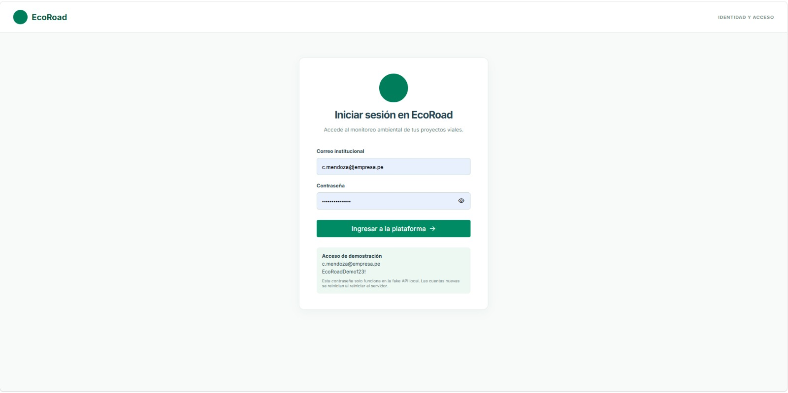

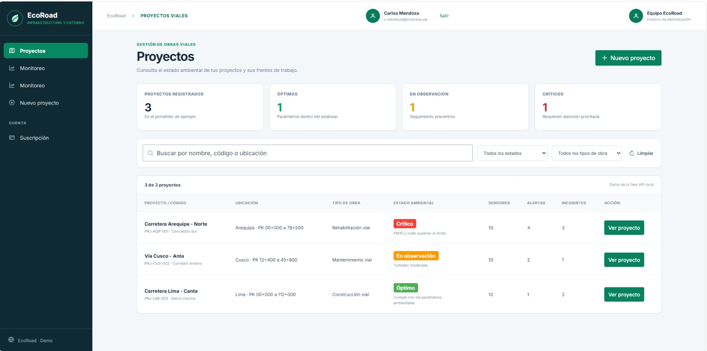

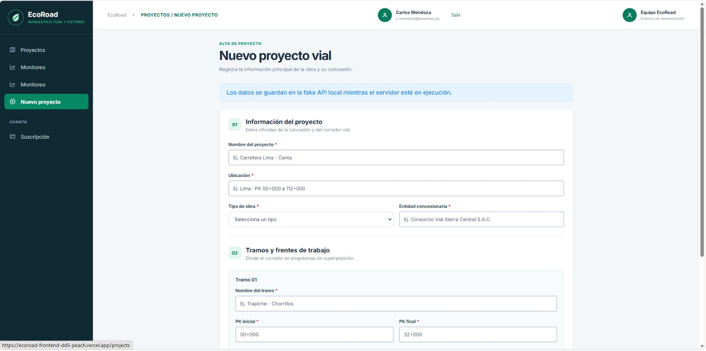

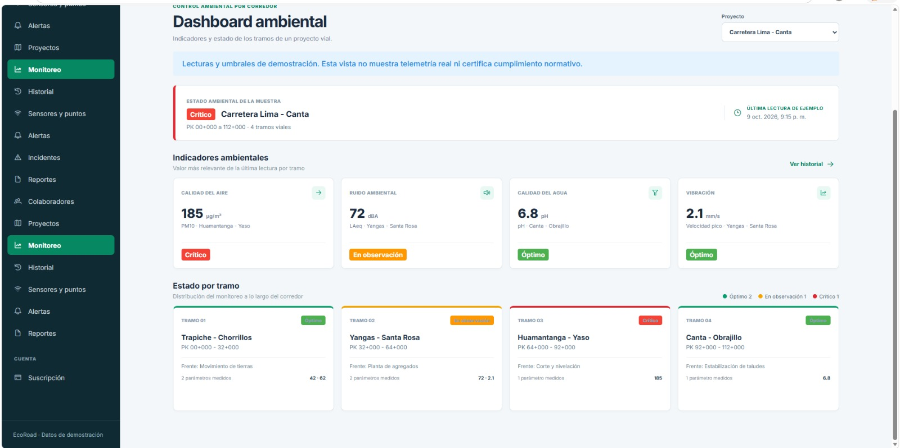

Video de evidencia:

https://upcedupe-my.sharepoint.com/:v:/g/personal/u20241d483_upc_edu_pe/IQBKnDlvgrUBTrm0ubp8ziwsAXeVyuD1lsqVZ1qMBecqAkw?nav=eyJyZWZlcnJhbEluZm8iOnsicmVmZXJyYWxBcHAiOiJPbmVEcml2ZUZvckJ1c2luZXNzIiwicmVmZXJyYWxBcHBQbGF0Zm9ybSI6IldlYiIsInJlZmVycmFsTW9kZSI6InZpZXciLCJyZWZlcnJhbFZpZXciOiJNeUZpbGVzTGlua0NvcHkifX0&e=rMrp5C

#### 5.2.2.6. Services Documentation Evidence for Sprint Review
<a id="5-2-2-6-services-documentation-evidence-for-sprint-review"></a>

En el Sprint 2 todavía no se implementaron los Web Services en ASP.NET Core, por lo que no existe documentación OpenAPI desplegada. Para permitir la integración de la Web Application, el equipo definió contratos HTTP provisionales por bounded context (carpeta `docs/` del repositorio `EcoRoad-FrontEnd`) y los implementó en una Fake API en Node.js, publicada como función serverless en Vercel bajo la ruta `/api`. Estos contratos sirven de base para los endpoints que se implementarán en ASP.NET Core en el Sprint 3.

**URL base:** `https://ecoroad-frontend-ddli-peach.vercel.app/api` — **Repositorio:** https://github.com/Aplicaciones-Web-1ASI0730-2620-8130/EcoRoad-FrontEnd

Las respuestas exitosas devuelven el recurso en JSON; los errores devuelven `{ code, message, errors? }` con el código HTTP correspondiente (por ejemplo 403 `SUBSCRIPTION_REQUIRED`, 404 `NOT_FOUND`, 409 conflicto de estado, 422 validación).

| Bounded Context | HTTP | Endpoint | Parámetros / Body | Response |
| :--- | :---: | :--- | :--- | :--- |
| IAM | POST | `/api/iam/sessions` | Credenciales del usuario | Token de sesión y datos del usuario |
| IAM | GET | `/api/iam/sessions/current` | — | Usuario de la sesión actual |
| IAM | GET | `/api/iam/users` | — | Colaboradores de la empresa |
| IAM | POST | `/api/iam/invitations` | Datos del colaborador | Colaborador invitado |
| IAM | PUT | `/api/iam/users/{id}/role` | `{ roleId }` | Colaborador con rol actualizado |
| IAM | PUT | `/api/iam/users/{id}/permissions` | Permisos | Colaborador con permisos actualizados |
| IAM | POST | `/api/iam/users/{id}/grant` · `/revoke` | — | Colaborador con acceso habilitado o revocado |
| Commercial | POST | `/api/company-accounts` | Razón social, RUC, tipo de empresa, contacto administrador | Identificador de la empresa |
| Commercial | GET | `/api/company-accounts/{companyId}/subscription` | — | Plan, estado, fecha de activación y vencimiento |
| Commercial | PUT | `/api/company-accounts/{companyId}/subscription/plan` | `{ planId: "base" \| "professional" \| "enterprise" }` | Suscripción con el plan seleccionado |
| Commercial | POST | `/api/company-accounts/{companyId}/subscription/activation-requests` | — | Solicitud de activación |
| Projects | GET | `/api/projects` | — | Lista de proyectos de la empresa |
| Projects | POST | `/api/projects` | Datos del proyecto | Proyecto creado (201) |
| Projects | GET | `/api/projects/{projectId}` | — | Proyecto con sus tramos |
| Projects | POST | `/api/projects/{projectId}/sections` | Datos del tramo | Tramo creado (201) |
| Projects | PUT · DELETE | `/api/projects/{projectId}/sections/{sectionId}` | Datos del tramo (PUT) | Tramo actualizado · `{ "deleted": true }` |
| Assets | GET | `/api/assets/points?projectId=` | `projectId` opcional | Puntos de monitoreo |
| Assets | POST | `/api/assets/points` | `{ projectId, sectionId, name, pk, latitude, longitude }` | Punto creado |
| Assets | GET | `/api/assets/sensors?projectId=&status=&search=` | Filtros opcionales | Inventario de sensores |
| Assets | POST | `/api/assets/sensors` | `{ name, serialNumber, type }` | Sensor registrado |
| Assets | POST | `/api/assets/sensors/{id}/assignment` · `/calibration` · `/activation` | `{ pointId }` · `{ validUntil }` · — | Sensor actualizado |
| Monitoring | GET | `/api/monitoring/projects/{projectId}/dashboard` | — | Indicadores, lecturas actuales y estado por tramo |
| Monitoring | GET | `/api/monitoring/projects/{projectId}/history?sectionId=&parameterId=&from=&to=` | Tramo, parámetro y rango de fechas | Lecturas históricas filtradas |
| Alerting | GET | `/api/alerts?projectId=&risk=&status=&search=` | Filtros opcionales | Alertas de la empresa |
| Alerting | GET | `/api/alerts/{id}` | — | Detalle de la alerta |
| Alerting | POST | `/api/alerts/{id}/acknowledgments` | `{ acknowledgedBy }` | Alerta atendida |
| Incidents | GET | `/api/incidents?status=&projectId=&search=` | Filtros opcionales | Incidencias de la empresa |
| Incidents | POST | `/api/incidents` | `{ alertId, description }` | Incidencia creada |
| Incidents | POST | `/api/incidents/{id}/assignment` | `{ userId }` | Incidencia con responsable |
| Incidents | POST | `/api/incidents/{id}/actions` | `{ description }` | Incidencia con acción correctiva |
| Incidents | POST | `/api/incidents/{id}/evidence` | `{ note, attachment? }` | Incidencia con evidencia |
| Incidents | POST | `/api/incidents/{id}/resolution` · `/closure` | — | Incidencia resuelta · cerrada |
| Compliance | POST | `/api/compliance/previews` | `{ projectId, from, to, sections }` | Consolidación para vista previa |
| Compliance | POST | `/api/compliance/reports` | `{ projectId, from, to, sections }` | Reporte generado (201) |
| Compliance | GET | `/api/compliance/reports?projectId=` | `projectId` | Reportes generados del proyecto |

**Commits relacionados con los contratos y la Fake API:** `1537151`, `44fd045`, `1e71d66`, `fa92cd6`, `313ab8c`, `7536be3`, `e415434`, `269161f`, `4039d15`.

#### 5.2.2.7. Software Deployment Evidence for Sprint Review
<a id="5-2-2-7-software-deployment-evidence-for-sprint-review"></a>

Durante el Sprint 2 se realizó el primer despliegue de la Frontend Web Application en Vercel y se publicó una nueva versión del Landing Page en GitHub Pages. Las actividades realizadas fueron:

1. **Importación del repositorio en Vercel:** desde la cuenta de Vercel del equipo se creó un nuevo proyecto importando el repositorio `Aplicaciones-Web-1ASI0730-2620-8130/EcoRoad-FrontEnd`, con el nombre `ecoroad-frontend`.

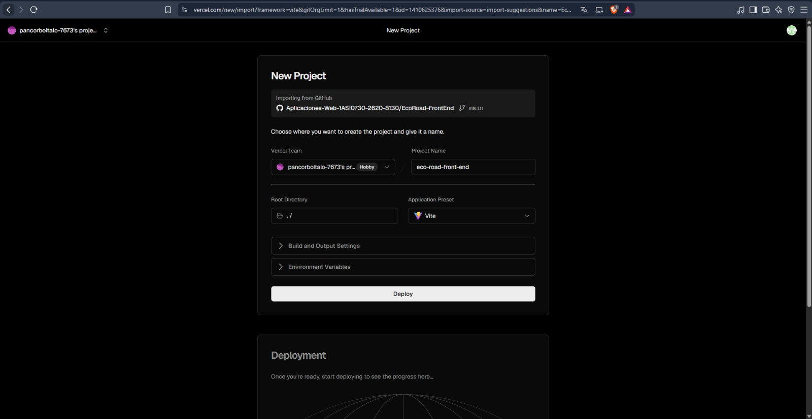

2. **Configuración del despliegue:** se agregó el archivo `vercel.json` (commit `6da08f2`) con las reglas de *rewrite* para la SPA y para la Fake API como función serverless (`api/index.js`), y se corrigieron los errores de integración del router y de la API (commits `99ae049` y `4039d15`).

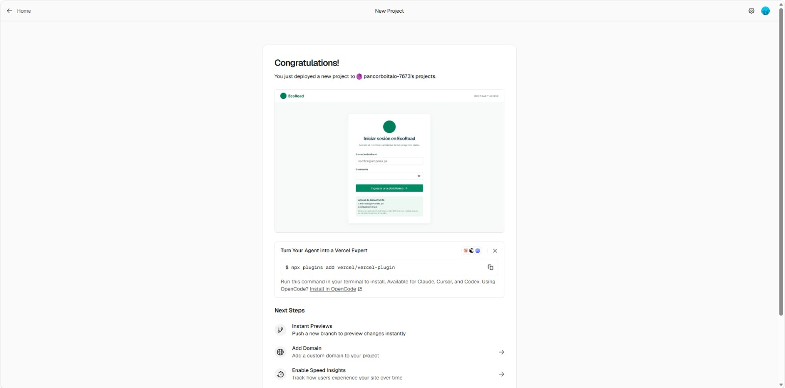

3. **Verificación del despliegue:** Vercel muestra el despliegue en estado *Ready* desde la rama `main`, publicado en https://ecoroad-frontend-ddli-peach.vercel.app/

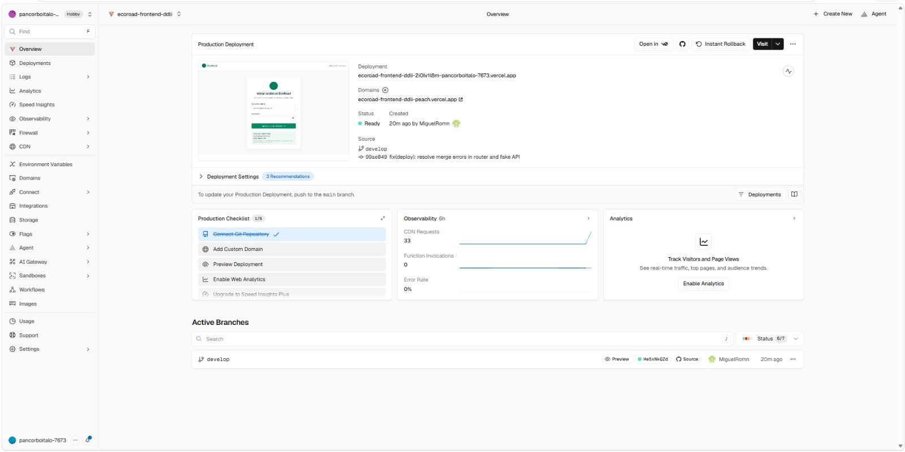

4. **Nueva versión del Landing Page:** se publicó en GitHub Pages el commit `24d6680`, que enlaza el call-to-action de inicio de sesión con la Web Application desplegada.

#### 5.2.2.8. Team Collaboration Insights during Sprint
<a id="5-2-2-8-team-collaboration-insights-during-sprint"></a>

Durante el Sprint 2 cada integrante implementó al menos un bounded context de la Web Application en su propia rama `ft-<Bounded-Context>`. Las ramas se integraron a `develop` mediante Pull Requests revisados por el Team Leader, y los conflictos de integración del router y de la Fake API se resolvieron antes del despliegue en Vercel. La coordinación se realizó en sesiones por Discord y mensajes por WhatsApp. La siguiente tabla resume la contribución por integrante en el repositorio de la Web Application según GitHub (incluye los commits de merge de Pull Requests).

| Integrante | Usuario GitHub | Bounded Context implementado | Commits (FrontEnd) |
|---|---|---|---|
| Pancorbo Amorós, Italo Raul | pancorboitalo-design | Commercial & Subscription, Project & Road Site, Environmental Monitoring, Landing Page | 22 |
| Roman Lopez, Miguel Angel Junior | MiguelRomn | Incident & Remediation, despliegue en Vercel | 5 |
| Guillen Chavez, Eduardo Martín | Eduardox30-wq | Alerting & Risk Evaluation, Monitoring Asset & Deployment | 3 |
| Salcedo Muñoz, Andy Alfredo Hipolito | Andy777sdw | Identity and Access Management | 2 |
| Taza Curay, Eduardo Miguel | Edutaza10 | Compliance & Reporting | 2 |

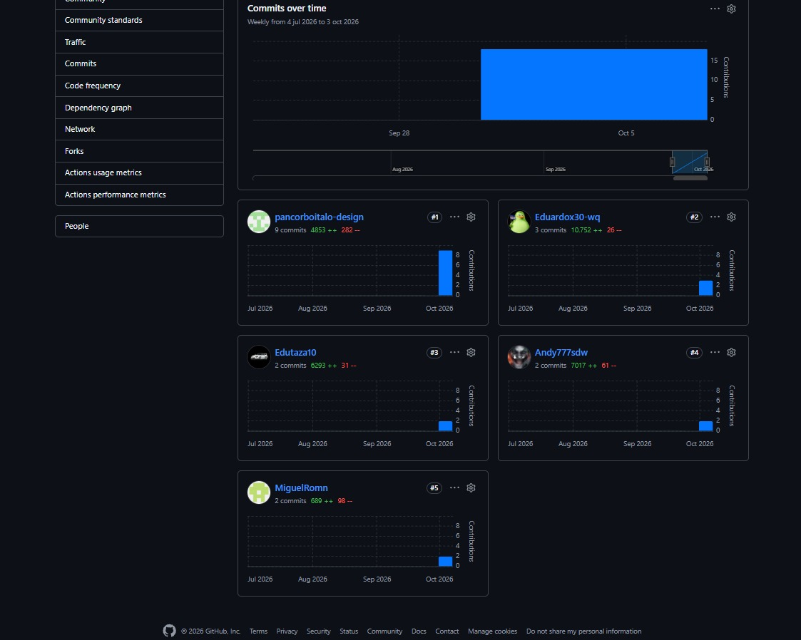

### 5.2.3. Sprint 3
<a id="5-2-3-sprint-3"></a>

#### 5.2.3.1. Sprint Planning 3
<a id="5-2-3-1-sprint-planning-3"></a>

El Sprint 3 se orientó a reemplazar la API simulada del Sprint 2 por servicios reales, persistir la información en MySQL y publicar una versión integrada de EcoRoad. El objetivo verificable fue recorrer desde la Landing Page el registro de empresa, el inicio de sesión y la gestión de un proyecto vial con monitoreo, alertas, incidencias y reportes, conservando los datos entre sesiones.

| Sprint # | Sprint 3 |
|:---|:---|
| **Sprint Planning Background** | Reunión informada por el organizador y reconstrucción técnica a partir de los repositorios. |
| Date | 13/10/2026 |
| Time | 08:00 PM |
| Location | Reunión virtual por Discord |
| Prepared By | Pancorbo Amorós, Italo Raul |
| Attendees | Taza Curay, Eduardo Miguel / Roman Lopez, Miguel Angel Junior / Guillen Chavez, Eduardo Martín / Salcedo Muñoz, Andy Alfredo Hipolito / Pancorbo Amorós, Italo Raul |
| Sprint 2 Review Summary | Se entregó una aplicación Vue con los ocho bounded contexts conectados a una Fake API en Vercel y una Landing Page enlazada al inicio de sesión. |
| Sprint 2 Retrospective Summary | `[pendiente de acta; no se atribuyen acuerdos no documentados]` |
| **Sprint Goal & User Stories** | |
| Sprint 3 Goal | Completar las actividades asignadas al backend para los ocho bounded contexts, integrar la Web Application con ASP.NET Core y MySQL, publicar la solución y comprobar el flujo de una empresa de demostración. |
| Criterio de revisión | Recorrido Landing Page → registro o inicio de sesión → proyecto y tramo → monitoreo, alertas e incidencias → reporte; verificación de endpoints en Scalar y despliegues en Railway. |
| Sprint 3 Velocity / Sum of Story Points | `[pendiente del tablero; no se calculan Story Points a partir de commits]` |

Como punto de partida técnico, la revisión del Sprint 2 dejó interfaces y contratos HTTP simulados. El trabajo del Sprint 3 incluyó persistencia real, adaptación de contratos entre frontend y backend, despliegue de los servicios y verificación del flujo público. Según el organizador, todas las actividades asignadas al backend se completaron. Las estimaciones y el acuerdo de retrospectiva siguen pendientes del tablero o acta.

#### 5.2.3.2. Aspect Leaders and Collaborators
<a id="5-2-3-2-aspect-leaders-and-collaborators"></a>

Al igual que en el capítulo de referencia, la tabla cruza integrantes con aspectos y utiliza `L` y `C`. Para EcoRoad, las letras **se infieren de los commits**: `L` indica la implementación principal y `C` una integración o corrección comprobable. La tabla no pretende documentar cargos acordados en una reunión.

| Team Member | GitHub Username | Backend Base | Commercial | IAM | Projects | Assets | Monitoring | Alerting | Incidents | Compliance | Frontend Integration | Deployment & Landing |
|:---|:---|:---:|:---:|:---:|:---:|:---:|:---:|:---:|:---:|:---:|:---:|:---:|
| Roman Lopez, Miguel Angel Junior | *MiguelRomn* | L | | L | | L | L | | L | | C | |
| Guillen Chavez, Eduardo Martín | *Eduardox30-wq* | | L | | L | | | C | | C | | C |
| Pancorbo Amorós, Italo Raul | *pancorboitalo-design / italopancor* | C | L | C | L | C | C | C | C | C | L | L |
| Taza Curay, Eduardo Miguel | *Edutaza10* | | | | | | | | | L | | |
| Salcedo Muñoz, Andy Alfredo Hipolito | *Andy (Andy777sdw)* | | | | | | | L | | | | |

*L = líder técnico según commits; C = colaborador en integración o corrección según commits.*

Las dos `L` de Commercial y Projects distinguen la implementación en rama de Italo de la integración posterior de Eduardo (`ead7ae1`, `08beacd`, `8566fb7`, `10b2615`). En Alerting se registran la implementación de Andy (`dea462d`, `2d56059`), trabajo inicial de Italo (`786238b`) e integración de Eduardo (`649bdeb`). En Compliance, Taza desarrolló el contexto en su rama (`5374cb5`, `7dbdd54`) y Eduardo lo integró (`e882b34`). Miguel aportó también correcciones de tooling del frontend (`a2740af`). La `C` de Eduardo en Deployment corresponde a Scalar (`e6f4f9b`); no demuestra que configuró Railway. Los nombres `Andy` e `italopancor` son autorías de Git vinculadas aquí con los integrantes por el contexto de los repositorios; revisar la identidad de autor en GitHub antes de usar los números como evaluación individual.

#### 5.2.3.3. Sprint Backlog 3
<a id="5-2-3-3-sprint-backlog-3"></a>

El backlog reconstruye las tareas terminadas a partir de commits de todas las ramas y del producto observado. Los códigos `T3-*` organizan esta sección del informe; no se presentan como ID del tablero. Las horas y Story Points siguen pendientes de cotejo con Trello. El organizador confirmó que las actividades asignadas al backend se completaron. `Done` indica implementación verificable en el repositorio, mientras que `Verificado en UI` indica además una observación en la aplicación publicada.

| Task ID | Aspecto / tarea | Entregable y criterio de revisión | Responsable técnico verificable | Evidencia | Estado |
|:---|:---|:---|:---|:---|:---|
| T3-01 | Base de Web Services y persistencia | Solución .NET, DbContext, repositorios y conexión MySQL | Roman Lopez | `9bf11f6`, `4f90b64`, `5a52832` | Done |
| T3-02 | IAM y control de acceso | Registro, sesiones, colaboradores, permisos y migración | Roman Lopez | `f996f76`, `a233b60`, `b45ee78` | Done |
| T3-03 | Activos y despliegue de sensores | Puntos, sensores, asignación, calibración y activación | Roman Lopez | `abf4721`, `5f8f413`; controladores de Assets | Done |
| T3-04 | Monitoreo ambiental | Mediciones, perfiles de umbral, dashboard e historial | Roman Lopez; corrección MySQL: Italo Pancorbo | Controladores de Monitoring; `d627226` | Done |
| T3-05 | Gestión de incidencias | Apertura, asignación, acciones, evidencias, resolución y cierre | Roman Lopez | `c0a7e0d`, `2012d74`, `d32e7ff`, `7871af1` | Done |
| T3-06 | Cuenta empresarial y suscripción | Registro y activación persistente de la empresa | Italo Pancorbo (rama inicial); Eduardo Guillen (integración) | `ead7ae1`, `c561342`, `8566fb7`, `8068edc` | Verificado en UI |
| T3-07 | Proyectos, tramos y frentes | Alta y consulta de proyectos con tramos; compatibilidad de ID de empresa | Italo Pancorbo (rama inicial y correcciones); Eduardo Guillen (integración) | `08beacd`, `d56d160`, `10b2615`, `1ea7d7b`, `95d452b` | Verificado en UI |
| T3-08 | Reglas y alertas ambientales | Evaluación de riesgo, reglas y migración | Andy Salcedo (rama inicial); Italo Pancorbo (trabajo inicial); Eduardo Guillen (integración) | `dea462d`, `2d56059`, `786238b`, `649bdeb`, `a7c0f42` | Done |
| T3-09 | Cumplimiento y reportes | Tablas, solicitud de reporte y generación PDF | Eduardo Taza (rama inicial); Eduardo Guillen (integración) | `5374cb5`, `7dbdd54`, `e882b34`, `5d5acc1` | Done |
| T3-10 | Documentación de API | Referencia Scalar y documento OpenAPI publicados | Eduardo Guillen | `e6f4f9b`; captura de Scalar en 5.2.3.6 | Verificado en UI |
| T3-11 | Integración de la Web Application | Repositorios HTTP reales para los ocho contextos y comprobación de lectura | Italo Pancorbo | `c30ae36`, `f212066`, `9880def`, `55d71fa`, `7505f65`, `b009ef4`, `edaf35b` | Done |
| T3-12 | Publicación del backend | Dockerfile y servicio ASP.NET Core accesible en Railway | Italo Pancorbo (Dockerfile); configuración final de Railway por confirmar | `f8518d2`; captura en 5.2.3.7 | Verificado en UI |
| T3-13 | Enlace y publicación de Landing Page | Registro e inicio de sesión dirigidos al frontend actual | Italo Pancorbo | `2713388`, `b277b7e` | Done |

#### 5.2.3.4. Development Evidence for Sprint Review
<a id="5-2-3-4-development-evidence-for-sprint-review"></a>

El backend usa ASP.NET Core sobre .NET 10 y Entity Framework Core con MySQL. Sus contextos de identidad, comercial, proyectos, activos, monitoreo, alertas, incidencias y cumplimiento exponen controladores REST. Las migraciones crean las tablas necesarias; `Program.cs` aplica las migraciones pendientes al iniciar. Los datos de ejemplo automáticos se cargan únicamente en el entorno `Development`, por lo que las cuentas y proyectos de producción deben registrarse o migrarse expresamente.

En el frontend, la integración sustituyó el consumo de datos simulados por repositorios HTTP para los mismos contextos. Se corrigieron diferencias de contratos y se añadió `npm run smoke:real` para comprobar rutas de lectura sin escribir datos. La Landing Page ahora dirige el acceso a la aplicación publicada en Railway, incluso durante la prueba local de la landing.

| Repositorio | Commit | Aporte |
|:---|:---|:---|
| Backend | `c0a7e0d`, `2012d74`, `d32e7ff` | Endpoints de incidencias, acciones correctivas y evidencias |
| Backend | `10b2615`, `bf1b706` | Gestión de proyectos y migración de sus tablas |
| Backend, rama de proyectos | `08beacd`, `d56d160` | Implementación inicial del dominio y API de proyectos |
| Backend, rama de comercial | `ead7ae1`, `c561342` | Modelo y API inicial de suscripciones |
| Backend, rama de alertas | `dea462d`, `2d56059`, `786238b` | Agregados y API iniciales de alertas desarrollados en ramas de trabajo |
| Backend | `649bdeb`, `a7c0f42` | Evaluación de alertas y migración |
| Backend, rama de cumplimiento | `5374cb5`, `7dbdd54` | Entidades y API iniciales de reportes |
| Backend | `e882b34`, `5d5acc1` | Reportes ambientales y migración |
| Backend | `e6f4f9b` | Referencia interactiva Scalar |
| Backend | `f8518d2` | Configuración Docker para Railway |
| Frontend | `c30ae36`, `f212066`, `9880def` | Integración de identidad, comercial, proyectos, activos y monitoreo |
| Frontend | `55d71fa`, `7505f65`, `b009ef4` | Integración de alertas, incidencias y reportes |
| Frontend | `28dfb3f`, `edaf35b` | Captura y evaluación de monitoreo; comprobación de API real |
| Landing Page | `2713388`, `b277b7e` | Enlaces de registro y acceso al frontend de Railway |

#### 5.2.3.5. Execution Evidence for Sprint Review
<a id="5-2-3-5-execution-evidence-for-sprint-review"></a>

Se comprobó manualmente el flujo publicado: desde la Landing Page se llega al registro o al inicio de sesión; se creó una cuenta empresarial de demostración con un correo bajo `ecoroad.example`, se inició sesión y se registró el proyecto **Mejoramiento del corredor vial Santa Rosa–Yangas** con tramo y frente de trabajo. En la aplicación se configuraron un perfil de umbral para PM10 y una regla diurna, se registró una lectura de demostración y se recorrieron las vistas de sensores y puntos, alertas, incidencias, colaboradores y reportes. En la vista de reportes se observó una solicitud vinculada al proyecto. Estas comprobaciones reflejan el recorrido observado; no equivalen a una prueba automatizada de extremo a extremo ni acreditan mediciones ambientales reales.

La siguiente captura muestra la vista de proyectos en el frontend publicado, con la sesión de demostración y el proyecto `VIA-SRY-01` recuperado del backend. Constituye evidencia visual de lectura de datos persistidos, aunque por sí sola no demuestra una nueva autenticación ni el resto del flujo.

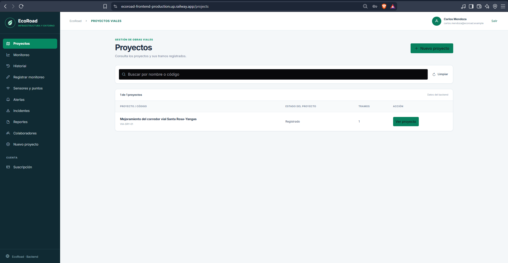

En el detalle del mismo proyecto se observan dos tramos activos, sus progresivas PK y las acciones para agregar, editar o eliminar tramos. La segunda captura muestra el formulario de edición abierto para **Santa Rosa–Yangas**, con los campos de nombre, PK inicial y PK final. Esta evidencia confirma que la interfaz permite llegar a la edición; no muestra una modificación guardada.

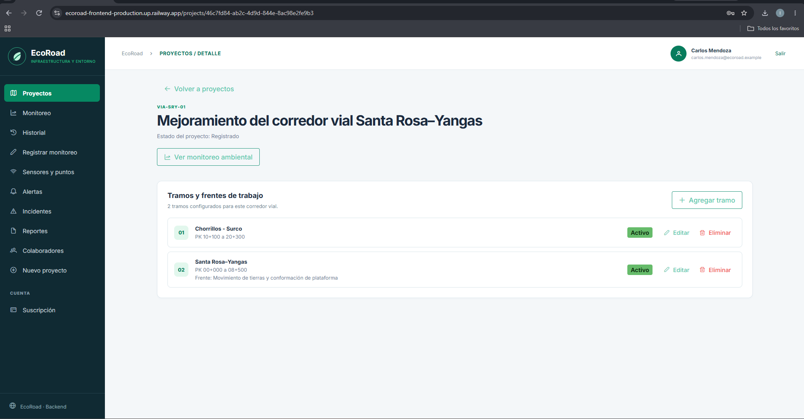

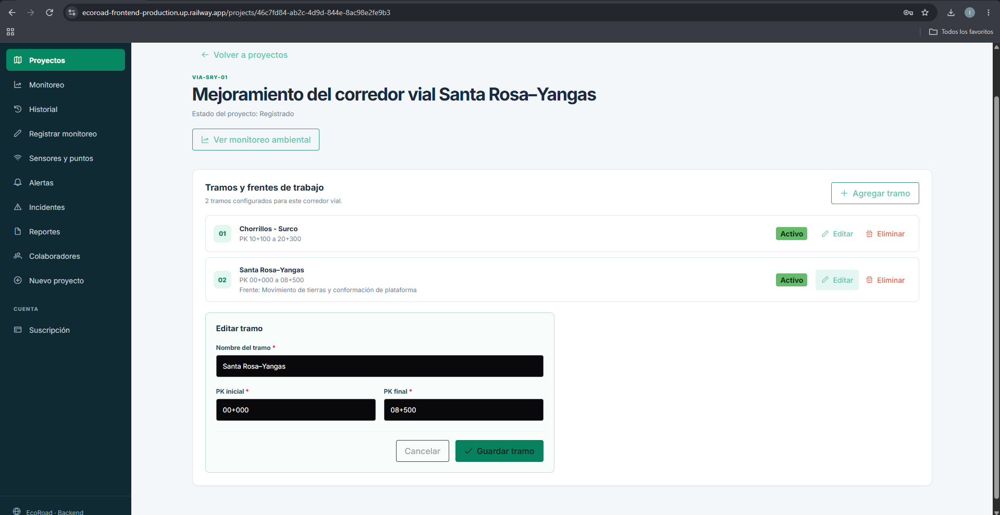

Para la revisión formal aún se requieren capturas fechadas o video de los demás pasos del flujo, el resultado de la prueba tras cerrar y volver a iniciar sesión y el registro de defectos encontrados. Las contraseñas, tokens y cadenas de conexión deben quedar fuera de las evidencias. El tablero de Trello con estimaciones e identificadores oficiales se incorporará cuando esté disponible.

#### 5.2.3.6. Services Documentation Evidence for Sprint Review
<a id="5-2-3-6-services-documentation-evidence-for-sprint-review"></a>

El backend publica el documento OpenAPI en `/openapi/v1.json` y la referencia interactiva Scalar en `/scalar`. Los controladores del código constituyen la fuente para comprobar métodos, cuerpos y respuestas de los servicios reales. A diferencia de los contratos provisionales del Sprint 2, las rutas implementadas incluyen `POST /api/company-accounts`, `POST /api/iam/sessions`, `GET/POST /api/projects`, `GET/POST /api/assets/sensors`, `GET/POST /api/monitoring/measurements`, `GET /api/alerts`, `GET/POST /api/incidents` y `POST /api/compliance-reports`. También existen operaciones específicas para tramos, calibración, umbrales, evaluación de alertas, acciones correctivas, evidencias y generación del documento PDF.

La URL pública de consulta es https://ecoroad-back-end-production.up.railway.app/scalar. La página inicial de Scalar identifica la API EcoRoad y permite descargar el documento OpenAPI; la vista de operaciones muestra las rutas de cuentas empresariales y suscripciones con métodos y parámetros. Las capturas evidencian la publicación de la documentación, no la ejecución exitosa de esos endpoints.

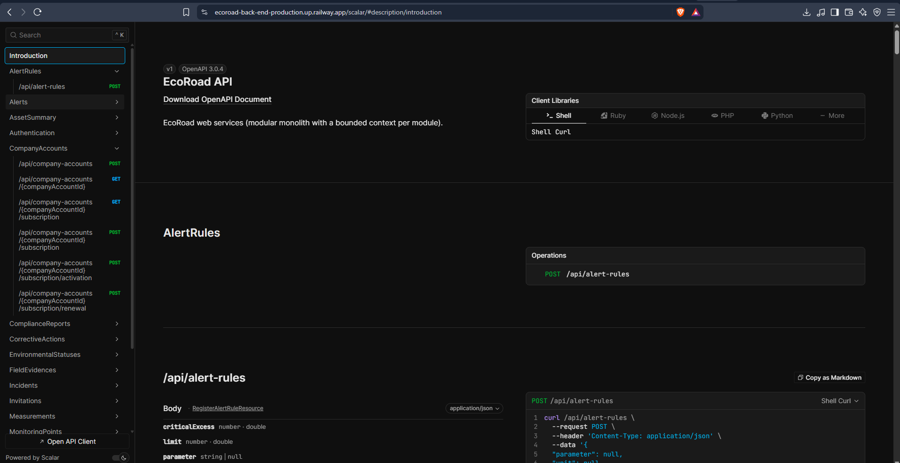

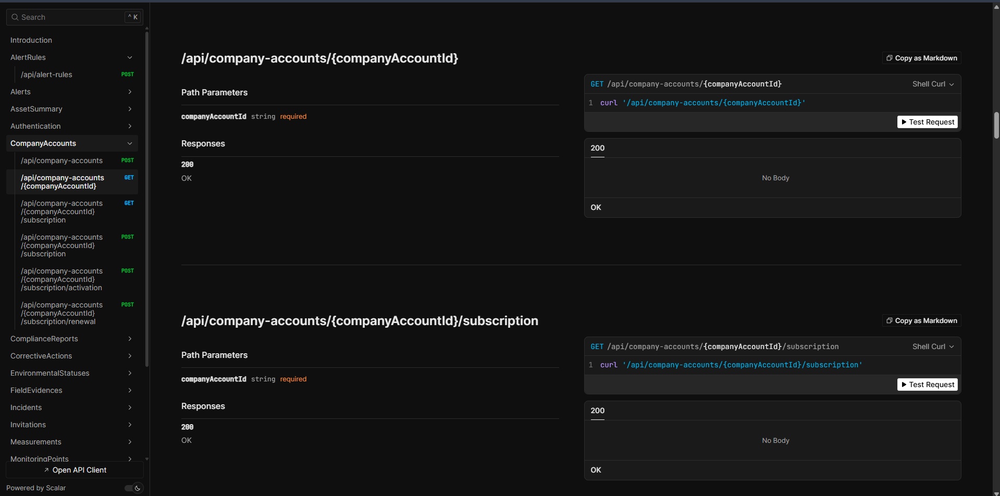

#### 5.2.3.7. Software Deployment Evidence for Sprint Review
<a id="5-2-3-7-software-deployment-evidence-for-sprint-review"></a>

La versión integrada utiliza tres servicios en Railway: frontend Vue, backend ASP.NET Core y MySQL. El backend se construye con el `Dockerfile` del repositorio y se conecta a la base de datos mediante configuración de entorno. La Landing Page permanece en GitHub Pages y su configuración `assets/app-config.js` apunta al frontend actual. Las direcciones observadas durante la revisión son:

- Landing Page: https://aplicaciones-web-1asi0730-2620-8130.github.io/EcoRoad-LandingPage/
- Web Application: https://ecoroad-frontend-production.up.railway.app/
- API y documentación: https://ecoroad-back-end-production.up.railway.app/scalar

La vista general de Railway muestra los servicios FrontEnd, BackEnd y MySQL en estado *Online*. El detalle del frontend muestra un despliegue activo y exitoso asociado a un commit de GitHub. En el backend se observa la presencia de `ConnectionStrings__DefaultConnection` con su valor oculto; esto acredita la configuración de la variable, sin exponer la cadena ni demostrar por sí solo una consulta a MySQL.

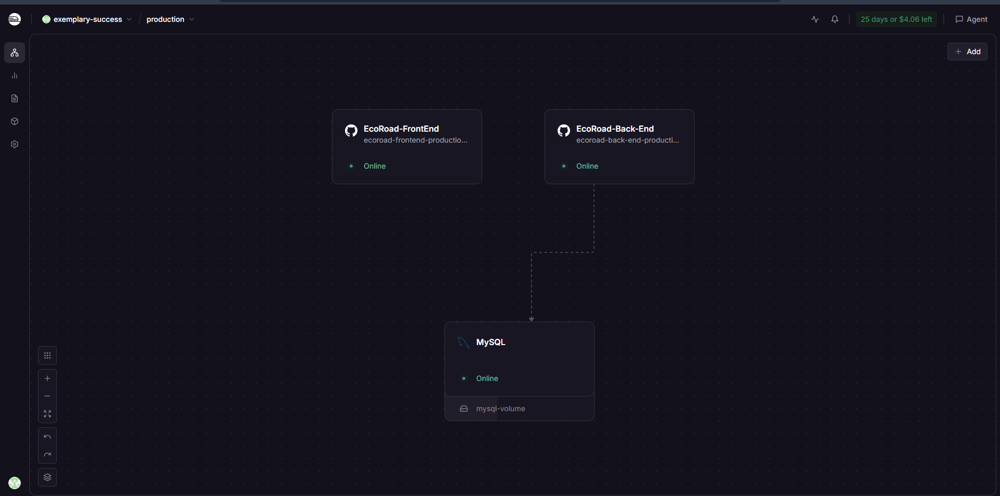

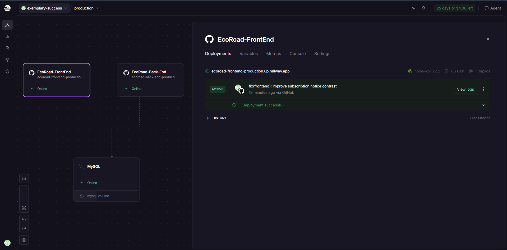

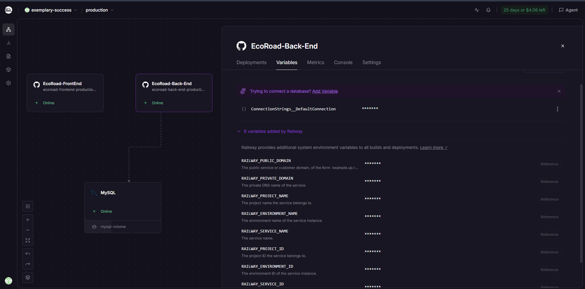

El repositorio de la Landing Page registra el nuevo enlace en `2713388` y su corrección para pruebas locales en `b277b7e`. La captura de GitHub Pages muestra el último despliegue de `main` en estado correcto y marcado como activo. Esto confirma la publicación de la landing actualizada; la prueba del flujo de acceso se documenta en 5.2.3.5.

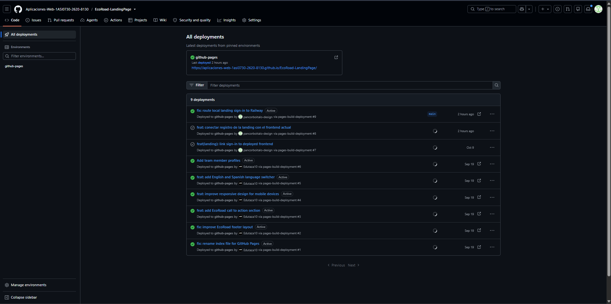

#### 5.2.3.8. Team Collaboration Insights during Sprint
<a id="5-2-3-8-team-collaboration-insights-during-sprint"></a>

Para el recuento se consultaron las ramas locales y de seguimiento remoto de los cuatro repositorios (`git log --branches --remotes`) y se contaron hashes únicos, sin commits de merge, entre el **13/10/2026 y el 14/11/2026**, inclusive, según la fecha de commit. Se excluyeron referencias de *stash*. Las distintas firmas `italopancor`, `italopan` y `pancorboitalo-design` se agruparon por el mismo correo de autor. La firma `Andy` del backend y del informe se presenta junto a Salcedo Muñoz por correspondencia con el trabajo de Alerting, pendiente de ratificación de identidad en GitHub. Los números son actividad de Git en el periodo, no horas trabajadas ni una medida de calidad; el informe incluye también cambios ajenos al capítulo 5.

| Integrante / autoría agrupada | Backend | Frontend | Landing Page | Report | Total |
|:---|---:|---:|---:|---:|---:|
| Roman Lopez, Miguel Angel Junior (`MiguelRomn`) | 177 | 7 | 0 | 0 | 184 |
| Pancorbo Amorós, Italo Raul (`italopancor`, `italopan`, `pancorboitalo-design`) | 28 | 12 | 2 | 9 | 51 |
| Guillen Chavez, Eduardo Martín (`Eduardox30-wq`) | 14 | 0 | 0 | 0 | 14 |
| Salcedo Muñoz, Andy Alfredo Hipolito (`Andy`) | 8 | 0 | 0 | 2 | 10 |
| Taza Curay, Eduardo Miguel (`Edutaza10`) | 6 | 0 | 0 | 0 | 6 |
| **Total de commits únicos sin merges** | **233** | **19** | **2** | **11** | **265** |

El backend concentró la mayor parte de los commits granulares: Miguel creó la base compartida e implementó IAM, activos, monitoreo e incidencias; Italo desarrolló en ramas iniciales proyectos, comercial y parte de alertas; Andy desarrolló la rama de alertas; Taza desarrolló la rama de cumplimiento; Eduardo integró comercial, proyectos, alertas y cumplimiento en la plataforma. En el frontend, Italo realizó las conexiones a la API real y Miguel aportó ajustes de acceso, navegación, pruebas y herramientas de calidad. La Landing Page recibió dos cambios para enlazarla a Railway. En el informe hubo actualizaciones de Italo y Andy. Algunos commits de ramas iniciales representan trabajo que luego fue sustituido o reimplementado durante la integración; el recuento no debe leerse como 265 entregables finales.

La integración reveló diferencias entre identificadores de empresa, representación de tramos, datos disponibles y rutas de operación. Las correcciones quedaron trazadas en `1ea7d7b`, `95d452b` y `4264b4c`. El aprendizaje técnico observable fue que la ejecución local o con Fake API no garantizaba el comportamiento en producción: hubo que verificar persistencia MySQL, contratos HTTP reales y redirecciones entre la Landing Page y la aplicación. Los acuerdos de retrospectiva del equipo permanecen pendientes de su acta.

## 5.3. Validation Interviews
<a id="5-3-validation-interviews"></a>

Esta sección queda preparada para documentar entrevistas de validación de la versión integrada de EcoRoad. Las preguntas son una guía semiestructurada: el entrevistador puede pedir ejemplos y profundizar en las respuestas. Ninguna entrevista ni conclusión se considera realizada hasta incorporar su registro y evidencia.

### 5.3.1. Diseño de Entrevistas
<a id="5-3-1-diseno-de-entrevistas"></a>

**Objetivo:** evaluar si EcoRoad ayuda a registrar proyectos viales, organizar el monitoreo ambiental, interpretar alertas, atender incidencias y preparar evidencia para reportes. También se busca identificar dificultades de uso y funciones faltantes antes de proponer mejoras.

**Perfiles a convocar:**

- Responsable de obra o de gestión de proyectos en una empresa constructora o de mantenimiento vial.
- Ingeniero, supervisor o consultor ambiental que registre mediciones, revise alertas o prepare reportes.

**Datos por completar antes de entrevistar:** número y criterio de selección de participantes; fechas; modalidad; duración; entrevistador; vínculo del participante con el proceso; método de consentimiento y autorización para grabar o citar. Usar códigos como `E01` en el informe y registrar datos personales solo cuando sea necesario y exista autorización.

#### Protocolo de entrevista

1. Explicar que se evalúa el producto, que no hay respuestas correctas y que la participación es voluntaria. Solicitar consentimiento para tomar notas y, por separado, para grabar.
2. Preguntar por la práctica actual del participante antes de mostrar EcoRoad.
3. Compartir la Landing Page y la aplicación publicada. Usar una cuenta de demostración autorizada y datos ficticios; no pedir al participante que introduzca credenciales personales.
4. Plantear tareas concretas y observar qué pasos intenta realizar, dónde se detiene y qué espera ver. Evitar guiarlo hasta que haya terminado cada tarea.
5. Formular las preguntas de cierre, registrar citas textuales breves con permiso y confirmar que el resumen representa su opinión.

**Tareas sugeridas para la prueba:** llegar desde la Landing Page al registro o inicio de sesión; encontrar el proyecto vial y su tramo; localizar un punto o sensor; interpretar una lectura PM10 y una alerta; revisar una incidencia y su acción correctiva; encontrar las fuentes de un reporte ambiental. Si alguna tarea requiere modificar datos de producción, usar un registro de demostración acordado y anotarlo en el acta.

#### Guía de preguntas

**Contexto del participante**

1. ¿Cuál es tu función en un proyecto vial y qué decisiones ambientales tomas o apoyas?
2. ¿Cómo registran hoy proyectos, tramos, puntos de monitoreo, mediciones e incidencias? ¿Qué herramientas utilizan?
3. ¿Qué información necesitas consultar con más frecuencia y cuánto tarda normalmente en estar disponible?

**Durante la prueba de EcoRoad**

4. Al ver la Landing Page, ¿qué entiendes que ofrece EcoRoad y a quién está dirigido? ¿Qué esperarías al pulsar el botón de registro?
5. ¿Te resultó claro cómo encontrar el proyecto, sus tramos y frentes de trabajo? ¿Qué dato te faltó para identificar el lugar correcto?
6. ¿Cómo interpretarías el valor de una medición, los umbrales y el estado de una alerta? ¿Qué harías después de verla?
7. ¿Qué información necesitarías para asignar, documentar y cerrar una incidencia de forma responsable?
8. ¿El reporte mostrado reúne la información que necesitarías para una revisión interna o una auditoría? ¿Qué evidencia o dato falta?
9. ¿En qué momento dudaste, tuviste que retroceder o necesitaste ayuda? Describe qué esperabas que ocurriera.

**Cierre**

10. ¿Qué parte del flujo te ahorraría trabajo en una situación real y cuál no utilizarías todavía? ¿Por qué?
11. ¿Qué riesgo o limitación te impediría usar EcoRoad con datos de un proyecto real?
12. Si pudieras cambiar una sola cosa antes de volver a probarlo, ¿cuál sería?
13. En una escala de 1 a 5, ¿qué tan fácil fue completar las tareas? ¿Qué explica esa calificación?

**Repreguntas opcionales por perfil:** a constructoras, consultar por varios proyectos, responsables y seguimiento de frentes; a supervisores ambientales, consultar por trazabilidad de mediciones, criterios de umbral, evidencias de campo y requisitos del reporte. No sugerir que la aplicación certifica cumplimiento normativo: el PDF actual resume identificadores y cantidades y no incorpora firma criptográfica verificada.

### 5.3.2. Registro de Entrevistas
<a id="5-3-2-registro-de-entrevistas"></a>

Repetir esta ficha por participante, sin sustituir sus respuestas por una interpretación del equipo:

| Campo | Registro |
|:---|:---|
| Código y perfil | `[E01; rol y tipo de organización]` |
| Fecha, duración y modalidad | `[pendiente]` |
| Entrevistador y consentimiento | `[pendiente; indicar si autorizó notas, grabación y cita]` |
| Tareas completadas / con ayuda / no completadas | `[pendiente; anotar el motivo observado]` |
| Necesidades y problemas previos | `[pendiente; preguntas 1–3]` |
| Hallazgos durante el recorrido | `[pendiente; preguntas 4–9 y observaciones]` |
| Valor percibido y barreras | `[pendiente; preguntas 10–12]` |
| Facilidad de uso y explicación | `[pendiente; respuesta a la pregunta 13]` |
| Citas autorizadas | `[pendiente; entrecomillar solo palabras efectivamente pronunciadas]` |
| Evidencia | `[enlace a notas, audio o video autorizado; conservar fuera del repositorio si contiene datos personales]` |

### 5.3.2. Registro de Entrevistas
<a id="5-3-2-registro-de-entrevistas"></a>

#### Entrevista 1 – Empresas constructoras

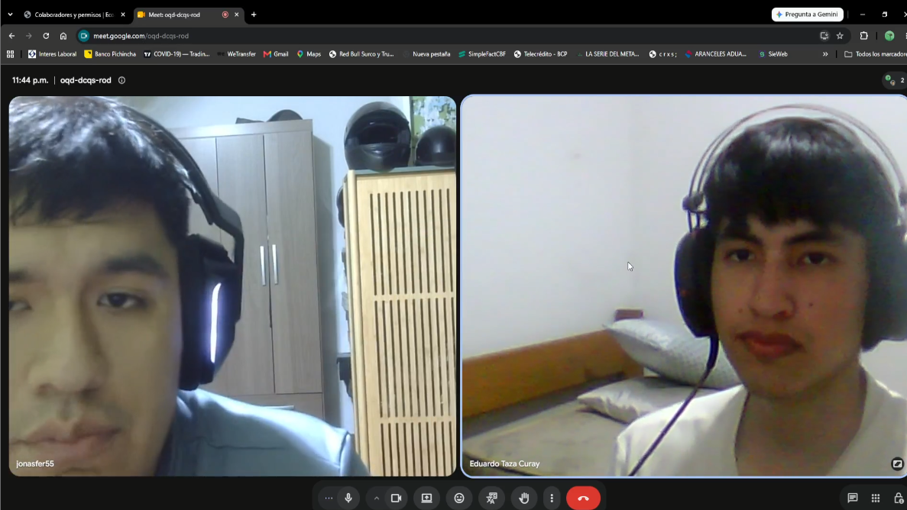

*Figura 1. Entrevista virtual realizada para la validación de EcoRoad en el segmento de empresas constructoras. Fuente: elaboración propia (2026).*


| Campo | Registro |
|:---|:---|
| **Código y perfil** | **E01 – Guillermo Guillén.** Participante de la validación de EcoRoad para el segmento de empresas constructoras. Cargo y organización por confirmar. |
| **Fecha, duración y modalidad** | 14/11/2026 (según la grabación). Duración aproximada: 15 minutos y 35 segundos. Modalidad virtual mediante Google Meet. |
| **Entrevistador y consentimiento** | En la grabación aparece Eduardo Tezza Curay; está pendiente confirmar si fue el entrevistador. No se ha verificado la autorización para notas, grabación y citas textuales. |
| **Tareas completadas / con ayuda / no completadas** | Se recorrieron los módulos de proyectos, monitoreo ambiental, historial de indicadores, sensores, alertas, reportes y colaboradores. No se pudo verificar qué tareas completó Guillermo de forma autónoma o con ayuda. |
| **Necesidades y problemas previos** | El guion abordó la priorización de frentes de trabajo, la asignación de acciones correctivas y la supervisión de múltiples proyectos. Las respuestas específicas del participante están pendientes de transcripción. |
| **Hallazgos durante el recorrido** | Se observaron las funcionalidades de monitoreo, sensores, alertas ambientales y reportes. El historial de indicadores no mostró lecturas para los filtros seleccionados y la sección de reportes no presentó informes generados. |
| **Valor percibido y barreras** | El guion evaluó la utilidad de las alertas, los indicadores ambientales y la supervisión de proyectos. La valoración real de Guillermo está pendiente de transcripción. |
| **Facilidad de uso y explicación** | Se presentó la navegación por los módulos principales. La opinión del entrevistado sobre la facilidad de uso requiere confirmación. |
| **Citas autorizadas** | Pendiente de verificar las declaraciones textuales y la autorización para utilizarlas. |
| **Evidencia** | [Ver grabación de la entrevista a Guillermo Guillén](https://upcedupe-my.sharepoint.com/:v:/g/personal/u20241d483_upc_edu_pe/IQCqPKYld0igT5AlgPayxBqbAayMrjuZTmtbagiBsJAQD4Y?e=gyO5HQ) |

#### Entrevista 2 – Empresas constructoras


*Figura 2. Entrevista virtual realizada para la validación de EcoRoad en el segmento de empresas constructoras. Fuente: elaboración propia (2026).*

| Campo | Registro |
|:---|:---|
| **Código y perfil** | **E02 – Viktor Gabriel Herrera.** Ingeniero de campo de una empresa constructora (segmento de empresas constructoras). Apoya a la jefatura de SSOMA en el seguimiento de tramos viales. Código sujeto a confirmación con el equipo. |
| **Nombres, apellidos, edad y distrito** | Viktor Gabriel Herrera. 29 años. Distrito: `[pendiente]`. |
| **Fecha, duración y modalidad** | 15/11/2026 (confirmar). Duración aproximada: 12 minutos y 24 segundos. La entrevista comienza en el minuto 00:00 del video. Modalidad virtual mediante videollamada. |
| **Entrevistador y consentimiento** | En la grabación aparece Miguel Román López como entrevistador. Consentimiento para notas, grabación y cita textual: `[pendiente de confirmar]`. |
| **Tareas completadas / con ayuda / no completadas** | Según sus respuestas, ubicó el proyecto `VIA-SRY-01` y sus tramos directamente. Interpretó las mediciones PM10 y el estado de la alerta. Dudó al pasar de la alerta al incidente generado y tuvo que usar el menú lateral para llegar a la sección de incidencias. Revisó el reporte en PDF. Lo anterior es lo declarado por el entrevistado; está pendiente verificarlo contra el video. |
| **Necesidades y problemas previos** | Registra mediciones e incidencias en hojas de Excel compartidas en Drive y grupos de WhatsApp. Cruzar las fotos con la tabla de mediciones es lo más tedioso y a veces se pierden mensajes o se pisan versiones. Obtener el consolidado diario tarda entre 4 horas y un día. |
| **Hallazgos durante el recorrido** | Entendió con rapidez la propuesta de la Landing Page. Echó en falta un filtro por progresivas. Esperaba que el código de la alerta llevara directo al incidente. Necesitaría ver si una medición viene de un equipo portátil o de una estación fija, y el código de calibración. |
| **Valor percibido y barreras** | Ahorraría tiempo con la centralización de mediciones por tramo y el resumen en PDF con un clic. No usaría todavía el cierre de incidentes si no permite adjuntar varias fotos o actas firmadas. Menciona como limitaciones la conectividad en tramos sin señal y quién puede editar o borrar una medición ya subida. |
| **Facilidad de uso y explicación** | 4 de 5. Valora la interfaz limpia y los términos propios de proyectos viales. No da 5 por el salto entre el módulo de alertas y el de incidentes. |
| **Citas autorizadas** | `[pendiente; confirmar autorización antes de citar textualmente]` |
| **Evidencia** | [Ver grabación de la entrevista a Viktor Gabriel Herrera](https://1drv.ms/v/c/6a55f7e464b104a9/IQCT08RctrLwT70FONFq_iwdAVCdN1m54ZUK0qMihwGpTIE?e=N2cq6Q). Inicio en 00:00 y duración de 12:24. |

**Perfil objetivo y subjetivo.** Es ingeniero de campo, coordina a unos 12 operarios y 3 capataces de frente, y sus decisiones ambientales incluyen programar el riego de vías con cisternas, reubicar acopios de material excedente y responder a las no conformidades ambientales de la supervisora. Trabaja con Excel, Drive y WhatsApp, y usa progresivas o kilómetros y coordenadas UTM como referencia. Dispositivos, navegador, marcas, influencias y rasgos de personalidad: `[pendiente; no se mencionan en las respuestas recibidas]`.

**Resumen de la entrevista.** Viktor Gabriel Herrera trabaja en una empresa constructora y hoy gestiona la información ambiental de los tramos con hojas de Excel y mensajes de WhatsApp. Describe que los técnicos envían fotos con coordenadas, que un asistente las consolida por la noche y que armar el consolidado del día puede tardar entre 4 horas y un día. Para sus decisiones necesita saber qué puntos de polvo (PM10) o ruido están cerca del límite en los frentes activos y qué incidentes siguen abiertos.

Al ver la Landing Page entendió que EcoRoad es una plataforma web para controlar el impacto ambiental y los frentes de obras viales, dirigida a ingenieros residentes, especialistas SSOMA y supervisores, y esperaba que el registro le permitiera crear una cuenta con su correo de empresa y elegir su rol o asociarse a un consorcio. Encontró el proyecto `VIA-SRY-01` del corredor Santa Rosa-Yangas sin dificultad y comprendió la división por tramos y frentes, aunque buscó un filtro por progresivas.

Sobre el monitoreo, considera que el indicador PM10 y los colores de estado permiten ver qué se disparó sin revisar fila por fila, y entiende el valor medido y el umbral superado. Para confiar plenamente en el dato pediría una etiqueta que indique si proviene de un equipo manual o de una estación fija y el código de calibración. Ante una alerta en rojo, su primera acción sería llamar al capataz del frente para enviar el camión cisterna.

En incidentes, vio el estado y la acción correctiva asociada. Para asignar y cerrar una incidencia en la práctica pediría el nombre y cargo del responsable, una fecha límite y un campo obligatorio para subir la foto del "después" con fecha y hora antes de marcarla como resuelta. Respecto al reporte, lo considera ordenado para reuniones de avance con gerencia o el cliente, y antes de descargarlo revisaría las fechas del corte y las coordenadas UTM. Indica que para una auditoría formal ante OEFA o MTC no bastaría por sí solo, porque allí se exigen certificados de laboratorio y cadenas de custodia firmadas.

Dudó al pasar de la alerta al incidente: esperaba que el código de la alerta abriera el detalle del incidente y tuvo que ir al menú lateral. Por eso su única mejora sería un enlace directo desde cada alerta hacia su incidente y su frente en el mapa o croquis. Calcula que el resumen en PDF con un clic le ahorraría al menos un par de horas cada viernes. Como barreras señala la falta de conectividad en tramos de sierra o quebradas, que exigiría guardar datos sin conexión, y la necesidad de controlar quién edita o borra mediciones. Calificó la facilidad de uso con 4 de 5.

En las repreguntas del segmento indicó que ver las alertas agrupadas por tramo le permite decidir a qué frente enviar primero la cuadrilla de mitigación. Para asignar una acción correctiva necesita responsable, plazo máximo, recursos requeridos y nivel de criticidad. Si gestionara varios proyectos, le sería indispensable un tablero tipo semáforo que compare cuántas alertas críticas o incidentes vencidos tiene cada consorcio.

| N.º | Respuesta registrada (resumen) |
|:---|:---|
| P1 | Ingeniero de campo; apoya a SSOMA; coordina 12 operarios y 3 capataces; programa riego con cisternas, reubica acopios y atiende no conformidades. |
| P2 | Excel en Drive, WhatsApp, fotos con coordenadas; pasan a una matriz por progresiva. Tedioso: cruzar fotos con mediciones y versiones pisadas. |
| P3 | Puntos de PM10 o ruido cercanos al límite e incidentes abiertos; el consolidado tarda de 4 horas a un día. |
| P4 | Plataforma web para controlar impacto ambiental y frentes; espera crear cuenta con correo de empresa y elegir rol o consorcio. |
| P5 | Ubicó `VIA-SRY-01` sin dificultad; echó en falta un filtro por progresivas. |
| P6 | Los colores y PM10 ayudan; pediría etiqueta manual o estación fija y código de calibración; ante alerta roja llamaría al capataz. |
| P7 | Pediría responsable con cargo, fecha límite y foto del "después" con fecha y hora obligatoria. |
| P8 | Sirve para reuniones internas y cliente; para auditoría OEFA o MTC faltan certificados de laboratorio y cadenas de custodia. |
| P9 | Dudó al pasar de la alerta al incidente; esperaba un enlace directo. |
| P10 | Ahorraría un par de horas cada viernes; no usaría aún el cierre sin adjuntar varias fotos o actas. |
| P11 | Conectividad en sierra y quebradas; permisos para editar o borrar mediciones. |
| P12 | Enlace directo de cada alerta a su incidente y a su frente en el mapa o croquis. |
| P13 | 4 de 5; no 5 por el salto entre alertas e incidentes. |
| Repreguntas | Agrupar alertas por tramo decide el frente prioritario; acción correctiva requiere responsable, plazo, recursos y criticidad; tablero tipo semáforo para varios proyectos. |


#### Síntesis y decisiones de producto

Después de realizar las entrevistas, resumir los hallazgos por tema y perfil. Indicar cuántos participantes mencionaron cada punto y distinguir lo observado durante una tarea de lo declarado en una respuesta. Evitar porcentajes con muestras pequeñas o no representativas.

| Hallazgo | Evidencia y participantes | Impacto en el flujo | Cambio propuesto | Prioridad / estado |
|:---|:---|:---|:---|:---|
| `[pendiente]` | `[códigos E01…, cita u observación]` | `[pendiente]` | `[pendiente]` | `[pendiente]` |

**Conclusión de validación:** `[pendiente de entrevistas y análisis; describir qué hipótesis se apoyan, cuáles no y qué se probará después]`.

### 5.3.3. Evaluaciones según heurísticas
<a id="5-3-3-evaluaciones-segun-heuristicas"></a>

**Estado:** pendiente de evaluación. Se propone revisar la versión desplegada de EcoRoad con las diez heurísticas de usabilidad de Nielsen, indicando evaluador, fecha, ruta y tarea observada. Cada hallazgo debe incluir captura o descripción reproducible, heurística afectada, gravedad, propuesta de corrección y resultado de una nueva revisión. No se asigna aquí una calificación global ni se afirma que la evaluación ya se realizó.

| ID | Pantalla y tarea | Heurística | Hallazgo verificable | Gravedad (0–4) | Mejora propuesta | Estado |
|:---|:---|:---|:---|:---:|:---|:---|
| `[H01]` | `[ruta y tarea]` | `[heurística]` | `[observación y evidencia]` | `[pendiente]` | `[pendiente]` | `[pendiente]` |

Como recorrido mínimo, evaluar el paso de la Landing Page al registro, la creación de empresa y proyecto, la comprensión de PK y umbrales, la captura de mediciones, la atención de alertas e incidencias y la generación de reportes. Registrar también hallazgos positivos, errores de validación y restricciones conocidas de la versión actual.

## 5.4. Video About-the-Product
<a id="5-4-video-about-the-product"></a>

El video de presentación de EcoRoad está disponible en el siguiente enlace. La captura proporcionada muestra el inicio de la grabación con la Landing Page desplegada en GitHub Pages. Para describir el resto del recorrido funcional en el informe se debe contrastar el contenido completo del video; esta imagen por sí sola no demuestra las pantallas posteriores.

**Video About-the-Product:** [Ver grabación de EcoRoad en OneDrive](https://1drv.ms/u/c/113B281D1AF386CE/IQDXJvOAgkOKTq1vVjRrzu_YAdsxD2o1nmj0KN3a8zEGrZE?e=CgGgNs)

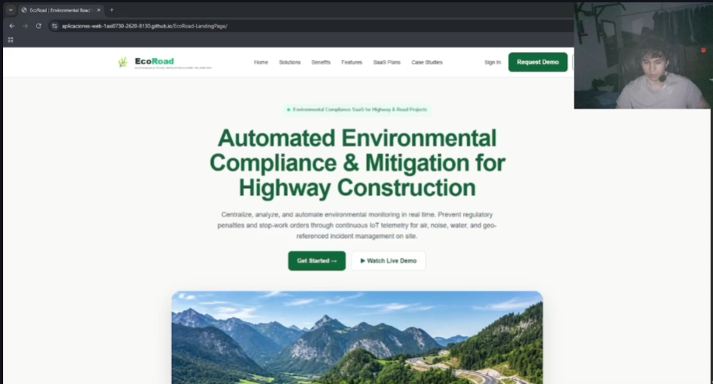
