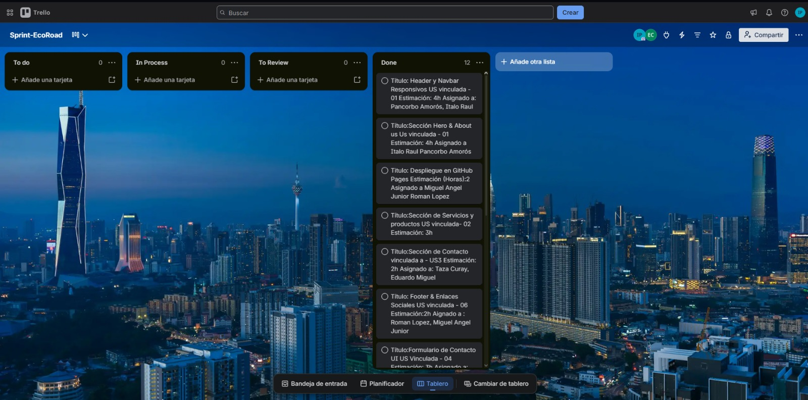

# Product Implementation, Validation & Deployment
<a id="product-implementation-validation-deployment"></a>

## 5.1. Software Configuration Management
<a id="5-1-software-configuration-management"></a>

En esta sección el equipo establece las decisiones y convenciones que permiten mantener la consistencia durante el ciclo de vida de los productos digitales de EcoRoad: Landing Page, Frontend Web Application y Web Services.

### 5.1.1. Software Development Environment Configuration
<a id="5-1-1-software-development-environment-configuration"></a>

#### Project Management
Para la coordinación del proyecto y el seguimiento del trabajo colaborativo se utilizaron plataformas de comunicación, almacenamiento y gestión ágil. El código fuente del informe, la Landing Page y la Web Application se centralizó en una organización pública de GitHub. Las reuniones virtuales del equipo y las coordinaciones diarias se realizaron mediante Discord y WhatsApp, mientras que la planificación y asignación de tareas de cada Sprint se gestionó en Trello.

* **Coordinación de código y repositorios:** GitHub — https://github.com/
* **Reuniones virtuales y syncs:** Discord — https://discord.com/
* **Comunicación diaria:** WhatsApp — https://www.whatsapp.com/
* **Organización y seguimiento de tareas (Sprint Board):** Trello — https://trello.com/

#### Requirements Management
Durante el análisis y la especificación de requisitos se empleó UXPressia para diseñar los User Personas, Empathy Maps, Journey Maps e Impact Maps. Se utilizó Miro para la construcción de los tableros de EventStorming.

* **User Personas, Empathy Maps, Journey Maps e Impact Map:** UXPressia — https://uxpressia.com/
* **EventStorming:** Miro — https://miro.com/
* **Gestión de User Stories y Sprint Backlog:** Trello — https://trello.com/

#### Product UX/UI Design
Para la concepción visual de la Landing Page y de la Web Application, el equipo empleó Figma. Se elaboraron wireframes, mock-ups y prototipos para validar la estructura visual, la paleta de colores y la disposición de las secciones antes de su implementación.

* **Wireframes, Mock-ups y Prototypes:** Figma — https://www.figma.com/

#### Software Development
La Landing Page se implementó con HTML5, CSS3 y JavaScript. La Frontend Web Application se implementa con Vue 3, Vue Router y la biblioteca de componentes PrimeVue, utilizando Vite como herramienta de construcción y Node.js como entorno de ejecución para las tareas de desarrollo y para la Fake API utilizada durante el Sprint 2. Los Web Services se implementarán con ASP.NET Core y Entity Framework Core en C#.

* **IDEs y editores:** Visual Studio Code — https://code.visualstudio.com/ ; WebStorm — https://www.jetbrains.com/webstorm/ ; JetBrains Rider (para C#) — https://www.jetbrains.com/rider/
* **Gestor de IDEs:** JetBrains Toolbox — https://www.jetbrains.com/toolbox-app/
* **Entorno de ejecución:** Node.js LTS — https://nodejs.org/
* **Framework y bibliotecas frontend:** Vue 3 — https://vuejs.org/ ; PrimeVue — https://primevue.org/ ; Vite — https://vite.dev/
* **Framework backend:** ASP.NET Core / .NET SDK — https://dotnet.microsoft.com/download
* **Control de versiones:** Git — https://git-scm.com/downloads

#### Software Documentation
El informe del proyecto se redacta en archivos Markdown (.md) dentro del repositorio del informe en GitHub, siguiendo el flujo de trabajo GitFlow. La documentación de los Web Services se elaborará con OpenAPI Specification vía Swagger.

* **Informe:** Markdown en GitHub — https://github.com/Aplicaciones-Web-1ASI0730-2620-8130/Grupo1---Report
* **Documentación de Web Services:** Swagger / OpenAPI — https://swagger.io/

#### Software Deployment
La Landing Page se publica en GitHub Pages y la Frontend Web Application en Vercel, ambas con despliegue continuo desde su repositorio de GitHub.

* **Landing Page:** GitHub Pages — https://pages.github.com/
* **Frontend Web Application:** Vercel — https://vercel.com/

### 5.1.2. Source Code Management
<a id="5-1-2-source-code-management"></a>

El equipo gestiona el código fuente mediante **GitHub** como plataforma de control de versiones, organizado bajo una organización pública que agrupa los repositorios de cada producto digital del proyecto.

| Producto | Repositorio | Despliegue |
| :--- | :--- | :--- |
| Project Report | https://github.com/Aplicaciones-Web-1ASI0730-2620-8130/Grupo1---Report | — |
| Landing Page | https://github.com/Aplicaciones-Web-1ASI0730-2620-8130/EcoRoad-LandingPage | https://aplicaciones-web-1asi0730-2620-8130.github.io/EcoRoad-LandingPage/ |
| Frontend Web Application | https://github.com/Aplicaciones-Web-1ASI0730-2620-8130/EcoRoad-FrontEnd | https://ecoroad-frontend-ddli-peach.vercel.app/ |
| Web Services | Se creará en el Sprint 3 | Se desplegará en el Sprint 3 |

#### GitFlow Workflow

El equipo implementa **GitFlow** como modelo de ramificación para gestionar el ciclo de vida del código. Las ramas definidas son:

- **`main`**: rama principal que contiene la versión estable publicada. Solo recibe merges desde `release` o `hotfix`.
- **`develop`**: rama de integración donde se consolidan los features completados antes de pasar a producción.
- **Feature branches**: se crean desde `develop` y se integran de vuelta a `develop` mediante Pull Request. Convenciones:
  - Project Report: `featureNN/Chapter-<número>-<nombre-del-capítulo>`, por ejemplo `feature50/Chapter-V-product-implementation-validation-and-deployment`.
  - Landing Page: `feature/<nombre-sección>`, por ejemplo `feature/hero-section`.
  - Frontend Web Application: `ft-<Bounded-Context>`, una rama por bounded context, por ejemplo `ft-Project-and-Road-Site-Management` o `ft-Incident-and-Remediation-Management`.
- **`release/<versión>`**: rama de preparación de una nueva versión. Se crea desde `develop` al cierre del Sprint. Ejemplo: `release/1.0.0`.
- **`hotfix/<descripción>`**: rama para correcciones críticas en producción. Se crea desde `main`. Ejemplo: `hotfix/fix-cta-redirect`.

#### Semantic Versioning

Para el nombramiento de versiones se aplica **Semantic Versioning 2.0.0** con el formato `MAJOR.MINOR.PATCH`:
- `MAJOR`: cambios incompatibles con versiones anteriores.
- `MINOR`: nuevas funcionalidades compatibles con versiones anteriores.
- `PATCH`: correcciones de errores compatibles con versiones anteriores.

| Producto | Sprint 1 | Sprint 2 |
| :--- | :--- | :--- |
| Landing Page | `v1.0.0` | `v1.1.0` (enlace del call-to-action de inicio de sesión hacia la Web Application) |
| Frontend Web Application | — | `v1.0.0` |

#### Conventional Commits

Para los mensajes de commit, el equipo aplica la especificación **Conventional Commits**, usando el formato:

```
<type>(<scope>): <description>
```

Los tipos permitidos son:
- `feat`: nueva funcionalidad.
- `fix`: corrección de error.
- `docs`: cambios en documentación.
- `style`: cambios de formato que no afectan la lógica.
- `refactor`: reestructuración de código sin cambio funcional.
- `chore`: tareas de mantenimiento (dependencias, configuración).
- `test`: adición o modificación de pruebas.

Ejemplos aplicados al proyecto:
```
docs(chapter5): add sprint 2 development evidence
feat(projects): manage road sections and work fronts
feat(incidents): add incident lifecycle and remediation board
fix(deploy): serve demo API and authentication on Vercel
feat(landing): link sign-in to deployed frontend
```

### 5.1.3. Source Code Style Guide & Conventions
<a id="5-1-3-source-code-style-guide-conventions"></a>

El equipo adopta las siguientes guías de estilo y convenciones de codificación para garantizar uniformidad y legibilidad en todos los productos. Toda nomenclatura en el código se redacta en **inglés**.

#### HTML5 & CSS3 (Landing Page y templates de la Web Application)
- Se aplica la guía **W3Schools HTML Style Guide and Coding Conventions**: estructura semántica, indentación con 2 espacios, elementos y atributos en minúsculas y uso de comillas dobles.
- Se aplica la guía **Google HTML/CSS Style Guide**: nombres de clases en `kebab-case`, se evita el uso de selectores de ID en CSS y se priorizan las propiedades abreviadas.
- El lenguaje de diseño se basa en **Material Design**.

#### JavaScript & Vue (Frontend Web Application)
- Se aplica la **Vue Style Guide** oficial: componentes con nombres multi-palabra, archivos de componentes en `kebab-case` (por ejemplo `project-list.vue`, `incident-board.vue`) y props declaradas de forma detallada.
- Se aplican **Google JavaScript Style Guide**, **MDN JavaScript guidelines** y **W3C JavaScript Style Guide**: `camelCase` para variables y funciones, `PascalCase` para clases, `const`/`let` en lugar de `var` y módulos ES.
- El código se organiza por bounded context y por capas: `domain`, `application`, `infrastructure` y `presentation` (por ejemplo `src/projects/presentation/views/project-list.vue`).
- Los componentes de interfaz se construyen con **PrimeVue**.

#### C# & ASP.NET Core (Web Services)
- Se aplican las **C# Coding Conventions** de Microsoft: `PascalCase` para clases, métodos y propiedades públicas; `camelCase` para parámetros y variables locales; prefijo `I` para interfaces.
- Se aplican las **Microsoft ASP.NET Core Coding Guidelines**: controladores con sufijo `Controller`, rutas REST en minúsculas y en plural (por ejemplo `/api/v1/projects`) e inyección de dependencias por constructor.

#### Gherkin (Acceptance Criteria)
- Se aplican las **Gherkin Conventions for Readable Specifications**: un solo nivel de indentación para `Given/When/Then`, escenarios redactados en tercera persona y en tiempo presente, sin referencias a detalles de interfaz.

### 5.1.4. Software Deployment Configuration
<a id="5-1-4-software-deployment-configuration"></a>

En esta sección se describe la configuración de despliegue de los productos digitales publicados hasta el Sprint 2.

#### Landing Page — GitHub Pages

El Landing Page de EcoRoad se despliega como sitio web estático mediante **GitHub Pages**, directamente desde su repositorio.

1. Asegurarse de que la rama `main` contiene los archivos del Landing Page (`index.html`, carpetas `css/`, `js/`, `assets/`).
2. Ingresar al repositorio en GitHub y navegar a **Settings > Pages**.
3. En la sección **Source**, seleccionar la rama `main` y la carpeta `/ (root)`.
4. Hacer clic en **Save**. GitHub Pages genera automáticamente la URL de despliegue.
5. Verificar el sitio desplegado en https://aplicaciones-web-1asi0730-2620-8130.github.io/EcoRoad-LandingPage/

Cualquier push a la rama `main` actualiza automáticamente el sitio desplegado.

#### Frontend Web Application — Vercel

La Web Application de EcoRoad (Vue 3 + Vite) se despliega en **Vercel**, conectado al repositorio `EcoRoad-FrontEnd`.

1. Ingresar a https://vercel.com/ con la cuenta de GitHub del equipo y seleccionar **Add New > Project**.
2. Importar el repositorio `Aplicaciones-Web-1ASI0730-2620-8130/EcoRoad-FrontEnd`.
3. Configurar el proyecto: **Root Directory** `./`, **Build Command** `npm run build` y **Output Directory** `dist`.
4. El archivo `vercel.json` del repositorio define las reglas de *rewrite*: las rutas `/api/*` se dirigen a la función serverless `api/index.js`, que expone la Fake API, y el resto de rutas se dirige a `index.html` para que Vue Router resuelva la navegación de la SPA.
5. Hacer clic en **Deploy**. Vercel construye la aplicación y publica la URL https://ecoroad-frontend-ddli-peach.vercel.app/
6. Cada push a la rama configurada genera un nuevo despliegue de forma automática.

## 5.2. Landing Page, Services & Applications Implementation
<a id="5-2-landing-page-services-applications-implementation"></a>

### 5.2.1. Sprint 1
<a id="5-2-1-sprint-1"></a>

#### 5.2.1.1. Sprint Planning 1
<a id="5-2-1-1-sprint-planning-1"></a>

El Sprint 1 se planificó con el propósito de implementar y desplegar la primera versión del Landing Page de EcoRoad. A continuación se resume la reunión de Sprint Planning.

| Sprint # | Sprint 1 |
| :--- | :--- |
| **Sprint Planning Background** | |
| Date | 2026-09-16 |
| Time | 07:00 PM |
| Location | Reunión virtual vía Discord |
| Prepared By | Pancorbo Amorós, Italo Raul |
| Attendees | Taza Curay, Eduardo Miguel / Roman Lopez, Miguel Angel Junior / Guillen Chavez, Eduardo Martín / Salcedo Muñoz, Andy Alfredo Hipolito / Pancorbo Amorós, Italo Raul |
| Sprint 0 Review Summary | Al ser el primer Sprint del proyecto, no existe un Sprint anterior. Se parte del Product Backlog inicial y de los artefactos de diseño elaborados en los capítulos previos. |
| Sprint 0 Retrospective Summary | El equipo acordó establecer estándares de trabajo desde el inicio: aplicar GitFlow, Conventional Commits y dividir las responsabilidades de implementación del Landing Page por secciones entre los miembros. |
| **Sprint Goal & User Stories** | |
| Sprint 1 Goal | Our focus is on delivering a fully deployed and navigable Landing Page for EcoRoad. We believe it delivers a clear understanding of the value proposition to potential clients from both target segments (road construction companies and road maintenance and rehabilitation companies). This will be confirmed when visitors can navigate all sections of the Landing Page, identify the environmental monitoring features, compare subscription plans, and access the call-to-action buttons for each segment. |
| Sprint 1 Velocity | 20 Story Points |
| Sum of Story Points | 19 Story Points |

#### 5.2.1.2. Aspect Leaders and Collaborators
<a id="5-2-1-2-aspect-leaders-and-collaborators"></a>

Para el Sprint 1, los aspectos de trabajo se organizan en torno a las secciones del Landing Page y la configuración del entorno de desarrollo y despliegue. Cada aspecto cuenta con un líder responsable de su implementación y uno o más colaboradores de apoyo.

| Team Member | GitHub Username | Hero & Navbar | Plans Section | Features Section | Contact Form | Deployment & Config |
|:---|:---|:---:|:---:|:---:|:---:|:---:|
| Taza Curay, Eduardo Miguel | Edutaza10 | L | C | | | C |
| Roman Lopez, Miguel Angel Junior | MiguelRomn | C | | L | C | C |
| Guillen Chavez, Eduardo Martín | Eduardox30-wq | C | | C | L | |
| Salcedo Muñoz, Andy Alfredo Hipolito | Andy777sdw | | L | C | | C |
| Pancorbo Amorós, Italo Raul | pancorboitalo-design | | C | C | | L |

*L = Leader | C = Collaborator*

#### 5.2.1.3. Sprint Backlog 1
<a id="5-2-1-3-sprint-backlog-1"></a>

El objetivo principal de este Sprint es implementar y desplegar la primera versión del Landing Page de EcoRoad, cubriendo las secciones de presentación de valor, funcionalidades, planes de suscripción, testimonios y formulario de contacto, con call-to-action diferenciados para cada segmento objetivo.



[Tablero de Trello: Organización del Sprint - EcoRoad](https://trello.com/invite/b/6ab0928cab1e6c824069d8ae/ATTI8217aefaf5493c7dc99f935bc7566209F12E82AE/sprint-ecoroad)

| US / TS / Task ID | Título | Descripción de Tarea | Estimación (Horas) | Integrante Asignado | Estado |
| :--- | :--- | :--- | :---: | :--- | :---: |
| **US001 / CC01** | Header y Navbar Responsivos | Maquetación y estilos responsive del encabezado y menú de navegación. | 4 | Pancorbo Amorós, Italo Raul | Done |
| **US001 / CC02** | Sección Hero & About Us | Maquetación visual de la sección principal y presentación de la empresa. | 4 | Pancorbo Amorós, Italo Raul | Done |
| **US002 / CC03** | Sección de Servicios y Producto | Maquetación de tarjetas informativas con las funcionalidades del SaaS. | 3 | Salcedo Muñoz, Andy Alfredo Hipolito | Done |
| **US003 / CC04** | Sección de Contacto | Maquetación de la sección informativa de canales de comunicación. | 2 | Taza Curay, Eduardo Miguel | Done |
| **US004 / CC05** | Formulario de Contacto UI | Desarrollo de la interfaz del formulario y validaciones en tiempo real. | 3 | Taza Curay, Eduardo Miguel | Done |
| **TS001 / CC06** | Footer & Enlaces Sociales | Maquetación del pie de página y enlaces a redes de la plataforma. | 2 | Roman Lopez, Miguel Angel Junior | Done |
| **TS001 / CC07** | Despliegue en GitHub Pages | Configuración del despliegue continuo desde la rama `main`. | 2 | Roman Lopez, Miguel Angel Junior | Done |
| **DOC01** | Informe Capítulo I | Introducción, problema, objetivos, justificación y restricciones. | 5 | Pancorbo Amorós, Italo Raul | Done |
| **DOC02** | Informe Capítulo II | Análisis del dominio, entrevistas, User Personas, Empathy Maps. | 6 | Salcedo Muñoz, Andy Alfredo Hipolito | Done |
| **DOC03** | Informe Capítulo III | Impact Mapping, User Stories y Product Backlog. | 8 | Guillen Chavez, Eduardo Martín / Taza Curay, Eduardo Miguel | Done |
| **DOC04** | Informe Capítulo IV | Arquitectura de Software, Domain-Driven Design y diagramas C4. | 6 | Roman Lopez, Miguel Angel Junior | Done |
| **DOC05** | Informe Capítulo V | Configuration Management, Sprint Planning 1 y evidencias de Sprint. | 5 | Guillen Chavez, Eduardo Martín | Done |

#### 5.2.1.4. Development Evidence for Sprint Review
<a id="5-2-1-4-development-evidence-for-sprint-review"></a>

En esta sección se presentan las evidencias correspondientes al desarrollo realizado durante el Sprint 1 del proyecto EcoRoad. Durante este Sprint, el equipo se enfocó en la implementación de la Landing Page, considerando la estructura visual, la navegación, la presentación de la propuesta de valor, los beneficios, las funcionalidades, los planes de suscripción, el equipo de trabajo y los elementos de contacto. Asimismo, se adaptó la interfaz a diferentes dispositivos, se incorporó un selector de idioma inglés/español y se publicó la Landing Page mediante GitHub Pages.

**Repository:** https://github.com/Aplicaciones-Web-1ASI0730-2620-8130/EcoRoad-LandingPage

**Deployed Landing Page:** https://aplicaciones-web-1asi0730-2620-8130.github.io/EcoRoad-LandingPage/

| Repository | Branch | Commit Id | Commit Message | Commit Message Body | Committed on (Date) |
| --- | --- | --- | --- | --- | --- |
| Aplicaciones-Web-1ASI0730-2620-8130/EcoRoad-LandingPage | main | d4db12f | feat: implement EcoRoad landing page | Implementación inicial de la Landing Page de EcoRoad, incluyendo su estructura principal, navegación y secciones informativas. | 19/09/2026 |
| Aplicaciones-Web-1ASI0730-2620-8130/EcoRoad-LandingPage | main | ea5e78f | fix: rename index file for GitHub Pages | Renombrado del archivo principal a `index.html` para su publicación en GitHub Pages. | 19/09/2026 |
| Aplicaciones-Web-1ASI0730-2620-8130/EcoRoad-LandingPage | main | 910f5d4 | fix: improve EcoRoad footer layout | Mejora de la estructura del footer: módulos, marco regulatorio, información de contacto y enlaces adicionales. | 19/09/2026 |
| Aplicaciones-Web-1ASI0730-2620-8130/EcoRoad-LandingPage | main | 51b5e02 | feat: add EcoRoad call to action section | Incorporación del call-to-action para solicitar demostraciones o contactar con especialistas. | 19/09/2026 |
| Aplicaciones-Web-1ASI0730-2620-8130/EcoRoad-LandingPage | main | 2525e7f | feat: improve responsive design for mobile devices | Adaptación de la Landing Page para su correcta visualización en computadoras, tablets y dispositivos móviles. | 19/09/2026 |
| Aplicaciones-Web-1ASI0730-2620-8130/EcoRoad-LandingPage | main | f37feac | feat: add English and Spanish language switcher | Incorporación del selector de idioma inglés/español (i18n). | 19/09/2026 |
| Aplicaciones-Web-1ASI0730-2620-8130/EcoRoad-LandingPage | main | 0fb8717 | Add team member profiles | Incorporación de los perfiles de los integrantes del equipo. | 20/09/2026 |

#### 5.2.1.5. Execution Evidence for Sprint Review
<a id="5-2-1-5-execution-evidence-for-sprint-review"></a>

Durante el presente Sprint se logró implementar y desplegar una primera versión funcional de la Landing Page de EcoRoad, orientada a presentar la propuesta de valor de la solución, sus principales funcionalidades, beneficios y planes de suscripción.

La Landing Page fue desarrollada utilizando HTML, CSS y JavaScript, incorporando una estructura responsive que permite su correcta visualización tanto en computadoras como en dispositivos móviles. Asimismo, se implementaron diferentes componentes interactivos que mejoran la experiencia de navegación del usuario.

**Resumen de logros**

- **Implementación de la Landing Page:** se desarrolló una primera versión funcional de EcoRoad, presentando de manera clara su propuesta de valor orientada al monitoreo y la gestión ambiental en proyectos de infraestructura vial.
- **Presentación de soluciones y beneficios:** se incorporaron secciones que muestran las principales soluciones de monitoreo ambiental, así como beneficios relacionados con reducción de riesgos, automatización de auditorías y trazabilidad georreferenciada.
- **Presentación de funcionalidades y modelo SaaS:** se implementaron secciones para mostrar funcionalidades como dashboards georreferenciados, alertas ambientales, trazabilidad de evidencias y generación de reportes, además de los planes de suscripción de la plataforma.
- **Secciones de equipo y contacto:** se añadieron las secciones de presentación del equipo y call-to-action, permitiendo al usuario conocer a los integrantes del proyecto y acceder a opciones de contacto o solicitud de demostración.
- **Diseño responsive e internacionalización:** la Landing Page fue adaptada para computadoras, tablets y smartphones, e incorpora un selector de idioma que permite alternar el contenido principal entre inglés y español.
- **Despliegue mediante GitHub Pages:** la solución fue publicada en un entorno web público, permitiendo validar su funcionamiento desde distintos dispositivos.

Video de demostración y navegación: [Link](https://upcedupe-my.sharepoint.com/:v:/g/personal/u20241d483_upc_edu_pe/IQAkn3u2kvFiTqMHYbNb0IjtAX7jKxhOE-uMBPIxo2_Q5Ys?nav=eyJyZWZlcnJhbEluZm8iOnsicmVmZXJyYWxBcHAiOiJPbmVEcml2ZUZvckJ1c2luZXNzIiwicmVmZXJyYWxBcHBQbGF0Zm9ybSI6IldlYiIsInJlZmVycmFsTW9kZSI6InZpZXciLCJyZWZlcnJhbFZpZXciOiJNeUZpbGVzTGlua0NvcHkifX0&e=Aga9p0)

Screenshot de la implementación:


#### 5.2.1.6. Services Documentation Evidence for Sprint Review
<a id="5-2-1-6-services-documentation-evidence-for-sprint-review"></a>

En este Sprint no se desarrollaron endpoints REST ni Web Services propios, debido a que el alcance estuvo enfocado en la implementación del Landing Page con HTML, CSS y JavaScript. Por ello, no existe documentación OpenAPI asociada a este Sprint. Se registra a continuación el recurso publicado y el repositorio que contiene su código fuente.

| Recurso | Acción implementada | HTTP | URL | Repositorio |
| :--- | :--- | :---: | :--- | :--- |
| Landing Page | Vista inicial y navegación de EcoRoad | GET | https://aplicaciones-web-1asi0730-2620-8130.github.io/EcoRoad-LandingPage/ | https://github.com/Aplicaciones-Web-1ASI0730-2620-8130/EcoRoad-LandingPage |

#### 5.2.1.7. Software Deployment Evidence for Sprint Review
<a id="5-2-1-7-software-deployment-evidence-for-sprint-review"></a>

Durante el Sprint 1 el despliegue se centró en la publicación del Landing Page como sitio web estático en GitHub Pages. Las actividades realizadas fueron:

1. **Creación del repositorio** `EcoRoad-LandingPage` dentro de la organización pública `Aplicaciones-Web-1ASI0730-2620-8130`.
2. **Preparación de la estructura del proyecto:** el archivo principal se renombró a `index.html` (commit `ea5e78f`) para que GitHub Pages lo reconozca como página de inicio.
3. **Configuración de GitHub Pages:** en **Settings > Pages** se seleccionó como origen la rama `main` y la carpeta `/ (root)`.
4. **Verificación del despliegue:** se comprobó el acceso al sitio publicado en https://aplicaciones-web-1asi0730-2620-8130.github.io/EcoRoad-LandingPage/ desde navegadores de escritorio y móviles.

> **[Pendiente: insertar captura de Settings > Pages del repositorio EcoRoad-LandingPage y captura del sitio publicado.]**

#### 5.2.1.8. Team Collaboration Insights during Sprint
<a id="5-2-1-8-team-collaboration-insights-during-sprint"></a>

Durante el Sprint 1 el trabajo de implementación del Landing Page y de elaboración del informe se distribuyó entre los integrantes según la matriz de Aspect Leaders and Collaborators. La integración de los aportes al informe se realizó mediante Pull Requests desde las ramas de cada capítulo hacia la rama `develop`, siguiendo GitFlow, y la coordinación técnica se mantuvo a través de Discord y WhatsApp. A continuación se presentan los analíticos de colaboración de GitHub.

**Analíticos de GitHub — Report**


**Analíticos de GitHub — Landing Page**


| Integrante | Usuario GitHub | Commits (Report) |
|---|---|---|
| Guillen Chavez, Eduardo Martín | Eduardox30-wq | 9 |
| Pancorbo Amorós, Italo Raul | pancorboitalo-design | 66 |
| Roman Lopez, Miguel Angel Junior | MiguelRomn | 0 |
| Taza Curay, Eduardo Miguel | Edutaza10 | 11 |
| Salcedo Muñoz, Andy Alfredo Hipolito | Andy777sdw | 11 |

### 5.2.2. Sprint 2
<a id="5-2-2-sprint-2"></a>

#### 5.2.2.1. Sprint Planning 2
<a id="5-2-2-1-sprint-planning-2"></a>

El Sprint 2 se planificó con el propósito de implementar y desplegar la primera versión de la Frontend Web Application de EcoRoad, cubriendo los ocho bounded contexts del dominio, y de actualizar el Landing Page para que su call-to-action dirija a la Web Application desplegada. A continuación se resume la reunión de Sprint Planning.

| Sprint # | Sprint 2 |
| :--- | :--- |
| **Sprint Planning Background** | |
| Date | 2026-10-08 |
| Time | 08:00 PM |
| Location | Reunión virtual vía Discord |
| Prepared By | Pancorbo Amorós, Italo Raul |
| Attendees | Taza Curay, Eduardo Miguel / Roman Lopez, Miguel Angel Junior / Guillen Chavez, Eduardo Martín / Salcedo Muñoz, Andy Alfredo Hipolito / Pancorbo Amorós, Italo Raul |
| Sprint 1 Review Summary | Durante el Sprint 1 se entregó la Landing Page completa y responsive de EcoRoad desplegada en GitHub Pages, con selector de idioma inglés/español, junto con la documentación técnica de los Capítulos I al V del informe. |
| Sprint 1 Retrospective Summary | El equipo mantuvo una sólida coordinación. Se identificó la necesidad de estandarizar las convenciones de arquitectura en Vue, definir una estructura uniforme por bounded context (domain, application, infrastructure, presentation), organizar la API simulada y sus relaciones de datos, y unificar el flujo GitFlow mediante nombres de ramas estandarizados por bounded context. |
| **Sprint Goal & User Stories** | |
| Sprint 2 Goal | Our focus is on delivering the first version of the EcoRoad Web Application, so that road construction and road maintenance companies can register their road projects, deploy monitoring points and IoT sensors, follow environmental indicators and alerts, manage incidents until their closure and generate compliance reports. We believe it delivers centralized and traceable visibility of environmental compliance to environmental engineers, site directors and project managers of both target segments. This will be confirmed when a user, coming from the Landing Page call-to-action, signs in to the deployed Web Application, registers a road project with its sections, reviews the environmental dashboard and the generated alerts, takes an incident from "Pendiente" to "Cerrada" with registered evidence, and generates a compliance report for a selected period. |
| Sprint 2 Velocity | 75 Story Points |
| Sum of Story Points | 72 Story Points |

#### 5.2.2.2. Aspect Leaders and Collaborators
<a id="5-2-2-2-aspect-leaders-and-collaborators"></a>

Para el Sprint 2, los aspectos de trabajo corresponden a los ocho bounded contexts implementados en la Frontend Web Application, más la actualización y el despliegue del Landing Page y de la Web Application. Cada aspecto cuenta con un líder responsable y colaboradores de apoyo.

| Team Member | GitHub Username | Commercial & Subscription | IAM | Project & Road Site | Monitoring Asset & Deployment | Environmental Monitoring | Alerting & Risk Evaluation | Incident & Remediation | Compliance & Reporting | Landing Page & Deployment |
|:---|:---|:---:|:---:|:---:|:---:|:---:|:---:|:---:|:---:|:---:|
| Taza Curay, Eduardo Miguel | Edutaza10 | | | L | L | | | | C | |
| Roman Lopez, Miguel Angel Junior | MiguelRomn | L | L | | | | | C | | C |
| Guillen Chavez, Eduardo Martín | Eduardox30-wq | | | | C | L | L | | | |
| Salcedo Muñoz, Andy Alfredo Hipolito | Andy777sdw | | C | | L | | | L | | |
| Pancorbo Amorós, Italo Raul | pancorboitalo-design | C | | L | | C | | | L | L |

*L = Leader | C = Collaborator*

#### 5.2.2.3. Sprint Backlog 2
<a id="5-2-2-3-sprint-backlog-2"></a>

El objetivo principal de este Sprint es implementar y desplegar la primera versión de la Frontend Web Application de EcoRoad con Vue 3 y PrimeVue, consumiendo una Fake API que simula los futuros Web Services, y actualizar el Landing Page para redirigir a la aplicación desplegada.

> **[Pendiente: insertar captura del tablero del Sprint 2 en Trello y su URL pública.]**

| Sprint # | Sprint 2 | | | | | | |
| :--- | :--- | :--- | :--- | :--- | :---: | :--- | :---: |
| **Story Id** | **Story Title** | **Task Id** | **Task Title** | **Task Description** | **Estimation (Hours)** | **Assigned To** | **Status** |
| US27 | CTA Segmento Constructoras Viales | T2-01 | Enlace de CTA hacia la Web Application | Actualizar los call-to-action del Landing Page para redirigir al inicio de sesión de la Web Application desplegada. | 1 | Pancorbo Amorós, Italo Raul | Done |
| US28 | CTA Segmento Mantenimiento Vial | T2-02 | Redirección al portafolio tras autenticación | Configurar la redirección del visitante hacia la vista de proyectos después de iniciar sesión. | 1 | Pancorbo Amorós, Italo Raul | Done |
| US01 | Autenticación de Usuarios | T2-03 | Vista de inicio de sesión | Implementar la vista de inicio de sesión, la sesión de usuario y la protección de rutas. | 4 | Salcedo Muñoz, Andy Alfredo Hipolito | Done |
| US25 | Registro de Colaboradores y Asignación de Permisos | T2-04 | Gestión de colaboradores | Implementar la vista de colaboradores con invitación, asignación de rol y permisos. | 4 | Salcedo Muñoz, Andy Alfredo Hipolito | Done |
| US26 | Restricción de Acceso según Permisos Asignados | T2-05 | Vista de acceso denegado y guardas de ruta | Restringir el acceso a vistas según los permisos del colaborador e implementar la vista de acceso denegado. | 3 | Salcedo Muñoz, Andy Alfredo Hipolito | Done |
| US30 | Creación de Proyecto Vial | T2-06 | Registro de proyectos viales | Implementar el formulario de registro de proyecto vial con validación de campos obligatorios. | 4 | Pancorbo Amorós, Italo Raul | Done |
| US30 | Creación de Proyecto Vial | T2-07 | Gestión de tramos y frentes de trabajo | Implementar el alta, edición y eliminación de tramos y frentes de trabajo de un proyecto. | 4 | Pancorbo Amorós, Italo Raul | Done |
| US11 | Visualización General de Proyectos | T2-08 | Listado de proyectos | Implementar la vista de listado de proyectos con estado ambiental, sensores, alertas e incidencias. | 3 | Pancorbo Amorós, Italo Raul | Done |
| US12 | Consulta de Resumen de un Proyecto | T2-09 | Detalle de proyecto | Implementar la vista de detalle de un proyecto con sus tramos. | 2 | Pancorbo Amorós, Italo Raul | Done |
| US33 | Asociación de Sensores IoT a Puntos de Monitoreo | T2-10 | Puntos de monitoreo y asignación de sensores | Implementar el registro de puntos de monitoreo geolocalizados y la asignación, calibración y activación de sensores. | 5 | Guillen Chavez, Eduardo Martín | Done |
| US10 | Consulta de Estado y Ubicación de Sensores IoT | T2-11 | Inventario de sensores | Implementar el inventario de sensores con filtros por proyecto, estado y búsqueda. | 3 | Guillen Chavez, Eduardo Martín | Done |
| US09 | Monitoreo de Mediciones en Tiempo Real | T2-12 | Lecturas actuales por tramo | Mostrar las lecturas actuales de los sensores y el estado ambiental por tramo. | 4 | Pancorbo Amorós, Italo Raul | Done |
| US13 | Consulta del Dashboard Ambiental de un Proyecto | T2-13 | Dashboard ambiental e histórico | Implementar el dashboard ambiental del proyecto y el gráfico histórico de indicadores. | 5 | Pancorbo Amorós, Italo Raul | Done |
| US15 | Consulta del Nivel de Riesgo de un Indicador | T2-14 | Evaluación de riesgo | Clasificar las mediciones en óptimo, advertencia o crítico según los umbrales configurados. | 3 | Guillen Chavez, Eduardo Martín | Done |
| US16 | Consulta de Alertas Generadas | T2-15 | Bandeja de alertas | Implementar la bandeja de alertas con filtros, detalle y registro de atención (acknowledgment). | 4 | Guillen Chavez, Eduardo Martín | Done |
| US18 | Registro de Incidencia Ambiental | T2-16 | Apertura de incidencias | Implementar la apertura de una incidencia a partir de una alerta. | 3 | Roman Lopez, Miguel Angel Junior | Done |
| US19 | Asignación de Responsable de Incidencia | T2-17 | Asignación de responsable | Permitir asignar un colaborador responsable a una incidencia. | 2 | Roman Lopez, Miguel Angel Junior | Done |
| US20 | Registro de Acción Correctiva | T2-18 | Registro de acciones correctivas | Permitir registrar acciones correctivas sobre una incidencia en proceso. | 2 | Roman Lopez, Miguel Angel Junior | Done |
| US22 | Registro de Evidencia de Campo | T2-19 | Registro de evidencias | Permitir registrar evidencias con nota y archivo adjunto. | 3 | Roman Lopez, Miguel Angel Junior | Done |
| US21 | Actualización de Estado de Incidencia | T2-20 | Tablero de ciclo de vida de incidencias | Implementar el tablero de incidencias con resolución y cierre formal, validando acción y evidencia. | 4 | Roman Lopez, Miguel Angel Junior | Done |
| US24 | Generación de Reporte Ambiental | T2-21 | Configuración y vista previa de reportes | Implementar la configuración del reporte por proyecto, periodo y secciones, con vista previa. | 4 | Taza Curay, Eduardo Miguel | Done |
| US23 | Consulta del Historial Ambiental de un Proyecto | T2-22 | Historial de reportes generados | Implementar la generación del reporte y el historial de reportes del proyecto. | 3 | Taza Curay, Eduardo Miguel | Done |
| — | Commercial and Subscription Management | T2-23 | Registro de empresa y suscripción | Implementar el registro de la cuenta de empresa y la selección y activación del plan de suscripción. | 5 | Pancorbo Amorós, Italo Raul | Done |
| — | Despliegue | T2-24 | Despliegue en Vercel | Configurar `vercel.json`, la función serverless de la Fake API y el despliegue de la Web Application. | 4 | Roman Lopez, Miguel Angel Junior | Done |
| — | Informe | T2-25 | Informe: Capítulo V – Sprint 2 | Documentar el Sprint 2 en el informe del proyecto. | 4 | Taza Curay, Eduardo Miguel / Pancorbo Amorós, Italo Raul | Done |

#### 5.2.2.4. Development Evidence for Sprint Review
<a id="5-2-2-4-development-evidence-for-sprint-review"></a>

Durante el Sprint 2 el equipo implementó la primera versión de la Frontend Web Application de EcoRoad con Vue 3, Vue Router y PrimeVue. El código se organizó por bounded context, cada uno con sus capas `domain`, `application`, `infrastructure` y `presentation`, y se desarrolló en una rama `ft-<Bounded-Context>` por contexto, integrada a `develop` mediante Pull Requests. Cada contexto consume una Fake API en Node.js que simula los futuros Web Services. Además, se actualizó el Landing Page para que su call-to-action de inicio de sesión dirija a la Web Application desplegada.

**Repositorio Frontend Web Application:** https://github.com/Aplicaciones-Web-1ASI0730-2620-8130/EcoRoad-FrontEnd

**Repositorio Landing Page:** https://github.com/Aplicaciones-Web-1ASI0730-2620-8130/EcoRoad-LandingPage

| Repository | Branch | Commit Id | Commit Message | Commit Message Body | Committed on (Date) |
| --- | --- | --- | --- | --- | --- |
| Aplicaciones-Web-1ASI0730-2620-8130/EcoRoad-FrontEnd | develop | cb4a256 | Initial commit | Creación del repositorio de la Web Application. | 08/10/2026 |
| Aplicaciones-Web-1ASI0730-2620-8130/EcoRoad-FrontEnd | ft-Commercial-and-Subscription-Management | 7b825b6 | feat(commercial): scaffold company registration and subscription demo | Estructura inicial del registro de empresa y de la suscripción. | 09/10/2026 |
| Aplicaciones-Web-1ASI0730-2620-8130/EcoRoad-FrontEnd | ft-Commercial-and-Subscription-Management | 708084c | feat(commercial): scaffold company registration and subscription demo | Vistas de registro de empresa y de planes de suscripción. | 09/10/2026 |
| Aplicaciones-Web-1ASI0730-2620-8130/EcoRoad-FrontEnd | ft-Commercial-and-Subscription-Management | 1537151 | feat(commercial): integrate fake API for subscription flows | Integración de los flujos de suscripción con la Fake API. | 09/10/2026 |
| Aplicaciones-Web-1ASI0730-2620-8130/EcoRoad-FrontEnd | ft-Project-and-Road-Site-Management | a9e3024 | feat(projects): add road project listing and registration | Listado y registro de proyectos viales. | 09/10/2026 |
| Aplicaciones-Web-1ASI0730-2620-8130/EcoRoad-FrontEnd | ft-Project-and-Road-Site-Management | da8d9b5 | fix(projects): set projects as default route. | Vista de proyectos como ruta por defecto. | 09/10/2026 |
| Aplicaciones-Web-1ASI0730-2620-8130/EcoRoad-FrontEnd | ft-Project-and-Road-Site-Management | b423996 | feat(projects): manage road sections and work fronts | Gestión de tramos y frentes de trabajo. | 09/10/2026 |
| Aplicaciones-Web-1ASI0730-2620-8130/EcoRoad-FrontEnd | ft-Environmental-Monitoring | 44fd045 | wip: preserve project API and environmental monitoring | Integración de la API de proyectos con el monitoreo ambiental. | 09/10/2026 |
| Aplicaciones-Web-1ASI0730-2620-8130/EcoRoad-FrontEnd | ft-Environmental-Monitoring | 1e71d66 | feat(monitoring): connect environmental views to fake api | Dashboard ambiental e histórico de indicadores conectados a la Fake API. | 09/10/2026 |
| Aplicaciones-Web-1ASI0730-2620-8130/EcoRoad-FrontEnd | ft-Alerting-and-Risk-Evaluation | a8d5031 | feat(alerting): add risk evaluation and alert inbox | Evaluación de riesgo y bandeja de alertas. | 09/10/2026 |
| Aplicaciones-Web-1ASI0730-2620-8130/EcoRoad-FrontEnd | ft-Alerting-and-Risk-Evaluation | fa92cd6 | feat(alerting): connect alert inbox and acknowledgments to fake API | Bandeja de alertas y registro de atención conectados a la Fake API. | 09/10/2026 |
| Aplicaciones-Web-1ASI0730-2620-8130/EcoRoad-FrontEnd | ft-Monitoring-Asset-and-Deployment | 313ab8c | feat(assets): implement monitoring asset and deployment context | Puntos de monitoreo, inventario, asignación, calibración y activación de sensores. | 09/10/2026 |
| Aplicaciones-Web-1ASI0730-2620-8130/EcoRoad-FrontEnd | ft-Compliance-and-Reporting | ed65bd7 | feat(compliance): add report configuration and preview | Configuración y vista previa de reportes ambientales. | 09/10/2026 |
| Aplicaciones-Web-1ASI0730-2620-8130/EcoRoad-FrontEnd | ft-Compliance-and-Reporting | 7536be3 | feat(compliance): integrate fake API for report generation and history | Generación e historial de reportes con la Fake API. | 09/10/2026 |
| Aplicaciones-Web-1ASI0730-2620-8130/EcoRoad-FrontEnd | ft-Identity-and-Access-Management-(IAM) | 4d3920a | add collaborator access model and management UI | Modelo de acceso de colaboradores y vista de gestión. | 09/10/2026 |
| Aplicaciones-Web-1ASI0730-2620-8130/EcoRoad-FrontEnd | ft-Identity-and-Access-Management-(IAM) | e415434 | feat(iam): completar autenticación y gestión de accesos con fake API | Autenticación y gestión de accesos conectadas a la Fake API. | 09/10/2026 |
| Aplicaciones-Web-1ASI0730-2620-8130/EcoRoad-FrontEnd | ft-Incident-and-Remediation-Management | 1d2864b | feat(incidents): add incident lifecycle and remediation board | Ciclo de vida de incidencias y tablero de remediación. | 09/10/2026 |
| Aplicaciones-Web-1ASI0730-2620-8130/EcoRoad-FrontEnd | ft-Incident-and-Remediation-Management | 269161f | feat(incidents): connect remediation workflow to fake API | Flujo de remediación conectado a la Fake API. | 09/10/2026 |
| Aplicaciones-Web-1ASI0730-2620-8130/EcoRoad-FrontEnd | develop | 6da08f2 | feat(develop): add vercel.json for deploy | Configuración de despliegue en Vercel. | 09/10/2026 |
| Aplicaciones-Web-1ASI0730-2620-8130/EcoRoad-FrontEnd | develop | 99ae049 | fix(deploy): resolve merge errors in router and fake API | Corrección de errores de integración en el router y la Fake API. | 09/10/2026 |
| Aplicaciones-Web-1ASI0730-2620-8130/EcoRoad-FrontEnd | develop | 4039d15 | fix(deploy): serve demo API and authentication on Vercel | Publicación de la Fake API y la autenticación como función serverless en Vercel. | 09/10/2026 |
| Aplicaciones-Web-1ASI0730-2620-8130/EcoRoad-LandingPage | main | 24d6680 | feat(landing): link sign-in to deployed frontend | Enlace del call-to-action de inicio de sesión hacia la Web Application desplegada. | 09/10/2026 |

#### 5.2.2.5. Execution Evidence for Sprint Review
<a id="5-2-2-5-execution-evidence-for-sprint-review"></a>

En el Sprint 2 se logró desplegar la primera versión de la Frontend Web Application de EcoRoad en https://ecoroad-frontend-ddli-peach.vercel.app/, accesible desde el call-to-action del Landing Page. Las vistas implementadas por bounded context son:

| Bounded Context | Vistas implementadas | Ruta |
| :--- | :--- | :--- |
| Identity and Access Management | Inicio de sesión, gestión de colaboradores, acceso denegado | `/iam/login`, `/iam/collaborators`, `/iam/forbidden` |
| Commercial and Subscription Management | Registro de empresa, planes y suscripción | `/commercial/...` |
| Project and Road Site Management | Listado de proyectos, nuevo proyecto, detalle de proyecto con tramos y frentes | `/projects`, `/projects/new`, `/projects/:id` |
| Monitoring Asset and Deployment | Puntos de monitoreo e inventario de sensores | `/assets/...` |
| Environmental Monitoring | Dashboard ambiental e histórico de indicadores | `/monitoring/...` |
| Alerting and Risk Evaluation | Bandeja de alertas con detalle y atención | `/alerts` |
| Incident and Remediation Management | Tablero de incidencias con asignación, acciones, evidencias, resolución y cierre | `/incidents` |
| Compliance and Reporting | Configuración, vista previa e historial de reportes | `/compliance/...` |


> **[Pendiente: insertar el enlace al video de navegación del Sprint 2 (upc-pre-202620-1asi0730-8130-Caiman-productnavigation-sprint-2).]**

#### 5.2.2.6. Services Documentation Evidence for Sprint Review
<a id="5-2-2-6-services-documentation-evidence-for-sprint-review"></a>

En el Sprint 2 todavía no se implementaron los Web Services en ASP.NET Core, por lo que no existe documentación OpenAPI desplegada. Para permitir la integración de la Web Application, el equipo definió contratos HTTP provisionales por bounded context (carpeta `docs/` del repositorio `EcoRoad-FrontEnd`) y los implementó en una Fake API en Node.js, publicada como función serverless en Vercel bajo la ruta `/api`. Estos contratos sirven de base para los endpoints que se implementarán en ASP.NET Core en el Sprint 3.

**URL base:** `https://ecoroad-frontend-ddli-peach.vercel.app/api` — **Repositorio:** https://github.com/Aplicaciones-Web-1ASI0730-2620-8130/EcoRoad-FrontEnd

Las respuestas exitosas devuelven el recurso en JSON; los errores devuelven `{ code, message, errors? }` con el código HTTP correspondiente (por ejemplo 403 `SUBSCRIPTION_REQUIRED`, 404 `NOT_FOUND`, 409 conflicto de estado, 422 validación).

| Bounded Context | HTTP | Endpoint | Parámetros / Body | Response |
| :--- | :---: | :--- | :--- | :--- |
| IAM | POST | `/api/iam/sessions` | Credenciales del usuario | Token de sesión y datos del usuario |
| IAM | GET | `/api/iam/sessions/current` | — | Usuario de la sesión actual |
| IAM | GET | `/api/iam/users` | — | Colaboradores de la empresa |
| IAM | POST | `/api/iam/invitations` | Datos del colaborador | Colaborador invitado |
| IAM | PUT | `/api/iam/users/{id}/role` | `{ roleId }` | Colaborador con rol actualizado |
| IAM | PUT | `/api/iam/users/{id}/permissions` | Permisos | Colaborador con permisos actualizados |
| IAM | POST | `/api/iam/users/{id}/grant` · `/revoke` | — | Colaborador con acceso habilitado o revocado |
| Commercial | POST | `/api/company-accounts` | Razón social, RUC, tipo de empresa, contacto administrador | Identificador de la empresa |
| Commercial | GET | `/api/company-accounts/{companyId}/subscription` | — | Plan, estado, fecha de activación y vencimiento |
| Commercial | PUT | `/api/company-accounts/{companyId}/subscription/plan` | `{ planId: "base" \| "professional" \| "enterprise" }` | Suscripción con el plan seleccionado |
| Commercial | POST | `/api/company-accounts/{companyId}/subscription/activation-requests` | — | Solicitud de activación |
| Projects | GET | `/api/projects` | — | Lista de proyectos de la empresa |
| Projects | POST | `/api/projects` | Datos del proyecto | Proyecto creado (201) |
| Projects | GET | `/api/projects/{projectId}` | — | Proyecto con sus tramos |
| Projects | POST | `/api/projects/{projectId}/sections` | Datos del tramo | Tramo creado (201) |
| Projects | PUT · DELETE | `/api/projects/{projectId}/sections/{sectionId}` | Datos del tramo (PUT) | Tramo actualizado · `{ "deleted": true }` |
| Assets | GET | `/api/assets/points?projectId=` | `projectId` opcional | Puntos de monitoreo |
| Assets | POST | `/api/assets/points` | `{ projectId, sectionId, name, pk, latitude, longitude }` | Punto creado |
| Assets | GET | `/api/assets/sensors?projectId=&status=&search=` | Filtros opcionales | Inventario de sensores |
| Assets | POST | `/api/assets/sensors` | `{ name, serialNumber, type }` | Sensor registrado |
| Assets | POST | `/api/assets/sensors/{id}/assignment` · `/calibration` · `/activation` | `{ pointId }` · `{ validUntil }` · — | Sensor actualizado |
| Monitoring | GET | `/api/monitoring/projects/{projectId}/dashboard` | — | Indicadores, lecturas actuales y estado por tramo |
| Monitoring | GET | `/api/monitoring/projects/{projectId}/history?sectionId=&parameterId=&from=&to=` | Tramo, parámetro y rango de fechas | Lecturas históricas filtradas |
| Alerting | GET | `/api/alerts?projectId=&risk=&status=&search=` | Filtros opcionales | Alertas de la empresa |
| Alerting | GET | `/api/alerts/{id}` | — | Detalle de la alerta |
| Alerting | POST | `/api/alerts/{id}/acknowledgments` | `{ acknowledgedBy }` | Alerta atendida |
| Incidents | GET | `/api/incidents?status=&projectId=&search=` | Filtros opcionales | Incidencias de la empresa |
| Incidents | POST | `/api/incidents` | `{ alertId, description }` | Incidencia creada |
| Incidents | POST | `/api/incidents/{id}/assignment` | `{ userId }` | Incidencia con responsable |
| Incidents | POST | `/api/incidents/{id}/actions` | `{ description }` | Incidencia con acción correctiva |
| Incidents | POST | `/api/incidents/{id}/evidence` | `{ note, attachment? }` | Incidencia con evidencia |
| Incidents | POST | `/api/incidents/{id}/resolution` · `/closure` | — | Incidencia resuelta · cerrada |
| Compliance | POST | `/api/compliance/previews` | `{ projectId, from, to, sections }` | Consolidación para vista previa |
| Compliance | POST | `/api/compliance/reports` | `{ projectId, from, to, sections }` | Reporte generado (201) |
| Compliance | GET | `/api/compliance/reports?projectId=` | `projectId` | Reportes generados del proyecto |

**Commits relacionados con los contratos y la Fake API:** `1537151`, `44fd045`, `1e71d66`, `fa92cd6`, `313ab8c`, `7536be3`, `e415434`, `269161f`, `4039d15`.

#### 5.2.2.7. Software Deployment Evidence for Sprint Review
<a id="5-2-2-7-software-deployment-evidence-for-sprint-review"></a>

Durante el Sprint 2 se realizó el primer despliegue de la Frontend Web Application en Vercel y se publicó una nueva versión del Landing Page en GitHub Pages. Las actividades realizadas fueron:

1. **Importación del repositorio en Vercel:** desde la cuenta de Vercel del equipo se creó un nuevo proyecto importando el repositorio `Aplicaciones-Web-1ASI0730-2620-8130/EcoRoad-FrontEnd`, con el nombre `ecoroad-frontend`.


2. **Configuración del despliegue:** se agregó el archivo `vercel.json` (commit `6da08f2`) con las reglas de *rewrite* para la SPA y para la Fake API como función serverless (`api/index.js`), y se corrigieron los errores de integración del router y de la API (commits `99ae049` y `4039d15`).


3. **Verificación del despliegue:** Vercel muestra el despliegue en estado *Ready* desde la rama `develop`, publicado en https://ecoroad-frontend-ddli-peach.vercel.app/


4. **Nueva versión del Landing Page:** se publicó en GitHub Pages el commit `24d6680`, que enlaza el call-to-action de inicio de sesión con la Web Application desplegada.

#### 5.2.2.8. Team Collaboration Insights during Sprint
<a id="5-2-2-8-team-collaboration-insights-during-sprint"></a>

Durante el Sprint 2 cada integrante implementó al menos un bounded context de la Web Application en su propia rama `ft-<Bounded-Context>`. Las ramas se integraron a `develop` mediante Pull Requests revisados por el Team Leader, y los conflictos de integración del router y de la Fake API se resolvieron antes del despliegue en Vercel. La coordinación se realizó en sesiones por Discord y mensajes por WhatsApp. La siguiente tabla resume la contribución por integrante en el repositorio de la Web Application según GitHub (incluye los commits de merge de Pull Requests).

| Integrante | Usuario GitHub | Bounded Context implementado | Commits (FrontEnd) |
|---|---|---|---|
| Pancorbo Amorós, Italo Raul | pancorboitalo-design | Commercial & Subscription, Project & Road Site, Environmental Monitoring, Landing Page | 22 |
| Roman Lopez, Miguel Angel Junior | MiguelRomn | Incident & Remediation, despliegue en Vercel | 5 |
| Guillen Chavez, Eduardo Martín | Eduardox30-wq | Alerting & Risk Evaluation, Monitoring Asset & Deployment | 3 |
| Salcedo Muñoz, Andy Alfredo Hipolito | Andy777sdw | Identity and Access Management | 2 |
| Taza Curay, Eduardo Miguel | Edutaza10 | Compliance & Reporting | 2 |

